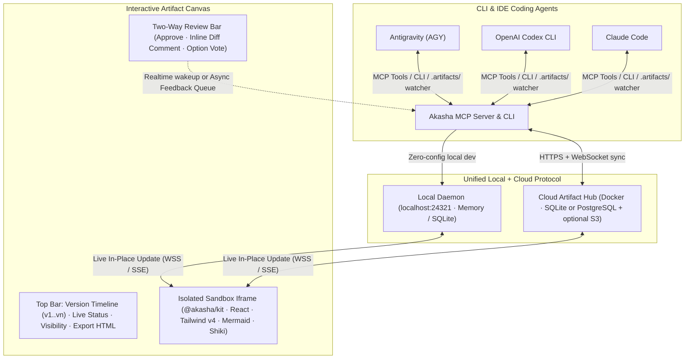

<p align="center">
  
</p>

<h1 align="center">Akasha (虚空) — Interactive Artifacts for Coding Agents</h1>

<p align="center">
  <em>uh-KAH-shuh · [əˈkɑːʃə] · Sanskrit &amp; Sumeru lore for "the ethereal terminal that projects knowledge into visible form"</em>
</p>

<p align="center">
  <strong>Open-Source Live Web Artifacts for CLI Coding Agents</strong><br>
  <em>Project terminal sessions from Claude Code, OpenAI Codex CLI, and Antigravity into live, versioned, interactive web artifacts — locally or on your own Cloud Hub.</em>
</p>

<p align="center">
  <a href="README.md">English</a> | <a href="README.zh-CN.md">简体中文</a>
</p>

<p align="center">
  <a href="https://github.com/VOD-Studio/akasha-artifacts/actions/workflows/ci.yml"></a>
  <a href="https://github.com/VOD-Studio/akasha-artifacts/releases"></a>
  <a href="LICENSE"></a>
</p>

---

> _"In Sumeru, the Akasha Terminal projects knowledge directly into the user's vision as an interactive holographic canvas."_

**Akasha** brings the power of **Claude Code Artifacts** and **`<antArtifact>` live sandboxes** to **every CLI and IDE coding agent** — including **Antigravity (AGY)**, **OpenAI Codex CLI**, **Claude Code**, **Gemini CLI**, and **Aider** — without locking your private codebase into a proprietary SaaS cloud.

---

## Why Akasha?

Terminal-based coding agents excel at editing files and running shell commands, but reading 800-line pull request diffs, tracking multi-step incident timelines, or exploring session data inside a monochrome terminal is painful.

Anthropic's official _Claude Code Artifacts_ solved this by publishing live web pages from a terminal session, but it comes with three hard limitations:

1. **Vendor & SaaS Lock-in**: Exclusive to Claude Code and requires uploading session payloads to `claude.ai` (restricted to paid Team/Enterprise tiers).
2. **One-Way Read-Only Snapshots**: Official artifacts have no feedback bridge—clicking "Approve" or annotating a diff line in the browser cannot wake up or instruct your CLI agent.
3. **Zero Pre-Built Engineering Primitives**: Models must hand-roll hundreds of lines of boilerplate UI from scratch on every turn.

**Akasha removes all three barriers:**

| Feature                   | Official Claude Code Artifacts     | Akasha (`VOD-Studio/akasha-artifacts`)                                                                       |
| :------------------------ | :--------------------------------- | :----------------------------------------------------------------------------------------------------------- |
| **Supported Agents**      | Claude Code only                   | **Antigravity, Codex CLI, Claude Code, Cursor, Gemini CLI, Aider** (via MCP & CLI)                           |
| **Hosting & Privacy**     | Mandatory `claude.ai` cloud upload | **Dual-Mode**: `localhost` zero-config daemon **+ Self-Hosted Cloud Hub** (Docker)                           |
| **Live In-Place Updates** | Yes                                | **Yes** — full version publishing (`v1..vn`) **+ zero-flicker JSON state streaming (`artifact_push_state`)** |
| **Engineering UI Kit**    | Raw HTML/React from scratch        | **Built-in `@akasha/kit`**: `<PRWalkthrough />`, `<LiveTimeline />`, `<OptionCompare />`, `<DataStory />`    |
| **Interaction Direction** | One-way (Read-only capture)        | **Two-way HITL**: inline diff comments, plan approvals, and option selections route back to the CLI agent    |

---

## Core Capabilities

### 1. Live, In-Place Updates (`artifact_publish` & `artifact_push_state`)

As your coding agent works through a task in the terminal, the open Akasha page updates dynamically in real time:

- **Versioned Snapshots (`v1, v2, v3...`)**: Every structural update creates an immutable version at the same URL with instant time-travel diffing.
- **Incremental State Streaming**: For long-running tasks (incident investigation, test suites, database migrations), the agent pushes lightweight JSON patches (`{ step: 3, status: "verified" }`) via WebSocket without rewriting the React component.

### 2. Five High-Frequency Engineering Templates (`@akasha/kit`)

Akasha pre-bundles an engineering component kit inside its sandbox so agents can render rich visual interfaces with minimal tokens:

- **Interactive PR Walkthroughs (`pr-walkthrough`)**: Annotated side-by-side or unified diffs with architectural walkthrough chapters and call-graph highlights.
- **Live Investigation & Task Timelines (`live-timeline`)**: Real-time status boards and release checklists that auto-check as the agent executes commands.
- **Side-by-Side Architecture Comparisons (`option-compare`)**: Compare multiple implementation proposals with live previews and a one-click _"Select Option & Notify Agent"_ button.
- **Session Data Stories & Dashboards (`data-story`)**: Turn SQL queries, logs, and MCP data pulled during a session into filterable charts and tables.
- **Sandboxed React / HTML / Mermaid / SVG (`react`, `html`, `mermaid`, `svg`)**: Full Tailwind CSS v4, Lucide icons, Recharts, and Shiki syntax highlighting out of the box.

### 3. Local-First + Cloud Hub Dual-Mode Architecture

- **Local Daemon Mode**: Instant `http://localhost:24321/a/:id` preview with zero external dependencies.
- **Self-Hosted Cloud Hub**: Deploy to your own domain (`https://akasha.your-team.dev/a/:id`) via a single Docker image.
  - **Origin-Isolated Sandbox**: Untrusted artifact HTML/React runs under a different registrable domain with its own strict CSP.
  - **Visibility Scopes**: `private` (creator & signed token), `team` (SSO / GitHub OAuth), or `public`.
  - **Live + Async Feedback Queue**: When your CLI is online (`● Live with Agent`), reviewer approvals wake the agent immediately. When your laptop is closed (`○ Snapshot`), teammate annotations are queued in the Cloud Hub and pulled automatically on your next session.

---

## Architecture



---

## Roadmap & Implementation Status

> Akasha is under active development. See the [Architecture Design](docs/design/architecture.md), [Domain Glossary](CONTEXT.md), [ADR-0001](docs/adr/0001-server-runtime-typescript-hono.md), and [v1 PRD (#5)](https://github.com/VOD-Studio/akasha-artifacts/issues/5) for the full specification.

| Milestone | Scope                                                                                                                                                        | Status    |
| :-------- | :----------------------------------------------------------------------------------------------------------------------------------------------------------- | :-------- |
| **M0**    | Monorepo workspace, `@akasha/ui` shell kit, `@akasha/protocol` (zod + JSON Schema), immutable versions & RFC 6902 StateStream                                | Completed |
| **M1**    | Machine-wide Local Daemon (Hono + SQLite), WebSocket resync, MCP tools, `check` gate, isolated sandbox with view-state preservation, multi-project web shell | Completed |
| **M2**    | L1 element picker & overlay, `ReviewRound` draft/submit anti-interruption loop, `receipt/ack`, multi-harness Hooks & Skills, runtime error fix loop          | Completed |
| **M3**    | `@akasha/kit` schema engine & L2 props panel, `artboard` / `document` / `verify`, L3 split code editor, `.artifacts/` native file storage                    | Completed |
| **M4**    | L4 visual direct editing (AST rewrite and undo), scoped storage, PR walkthrough and data story templates                                                     | Completed |
| **M5**    | Self-hosted Docker Cloud Hub (OAuth, visibility scopes, offline queue, local-daemon direct fallback)                                                         | Completed |
| **M6**    | Optional Cloudflare Workers deployment ([#29](https://github.com/VOD-Studio/akasha-artifacts/issues/29))                                                     | Deferred  |

Simultaneous multi-user editing is not implemented and is separate from how the Hub is hosted.

---

## Quick Start

> [!NOTE]
> `akasha serve` runs the local workbench, MCP backend and isolated sandbox. Open an `artboard` artifact to compare independently sized boards. Use the page and board picker to navigate or copy a link to the current page at the current version scope. HTML and React artifacts open on a single board; the comments drawer and inline editing of static nodes remain available. The Kit also includes `pr-walkthrough` and `data-story`. The Hub deployment options below require your own origins and OAuth App.

### 1. Connect to Your Coding Agent (MCP & Hooks — M1/M2)

#### One-Command Plugin Install (Claude Code / Antigravity / Codex CLI / Cursor)

```bash
# Install MCP configuration, harness Hooks, and lightweight Skills idempotently
npx -y akasha-artifacts install --harness claude-code
# Verify Node.js, Daemon health, port conflicts, and plugin installation
npx -y akasha-artifacts doctor --harness claude-code
```

#### Manual MCP Configuration (Antigravity / Claude Code / Codex CLI)

Add Akasha to your MCP configuration:

```json
{
  "mcpServers": {
    "akasha": {
      "command": "npx",
      "args": ["-y", "akasha-artifacts", "mcp"],
      "env": {
        "AKASHA_HUB_URL": "http://localhost:24321"
      }
    }
  }
}
```

Or with Claude Code CLI:

```bash
claude mcp add akasha -- npx -y akasha-artifacts mcp
```

### 2. Cloud Hub Deployment (Docker)

Docker is the default Cloud Hub deployment and does not require Cloudflare. Follow the [single-image deployment guide](deploy/docker/README.md) and configure [environment variables](deploy/docker/.env.example). SQLite is the default; PostgreSQL and S3-compatible blob storage are optional. The shell and sandbox require separate registrable domains in production.

Sign in, then connect the MCP process to your team's Hub:

```bash
npx akasha-artifacts login --hub https://akasha.example.com
npx akasha-artifacts mcp --hub https://akasha.example.com
```

A Hub link uses the local workbench instead when it is paired to that Hub and already holds the same artifact.

### 3. Artifact-scoped storage

```js
await window.akasha.storage.set('layout', { compact: true })
const layout = await window.akasha.storage.get('layout')
const keys = await window.akasha.storage.list({ scope: 'shared', prefix: 'team:' })
await window.akasha.storage.delete('layout')
```

The default scope is `private`, isolated by user and artifact. `shared` is readable by viewers of that artifact and writable by its editors. Limits per scope: 128 keys and 64 KiB in total; each key is limited to 128 bytes and each JSON value to 16 KiB. A missing key returns `null`. Storage is proxied through the shell; the sandbox does not make network requests.

---

## MCP Tools Reference

> All 10 MCP tools defined in `@akasha/protocol` are live in Local Daemon & stdio MCP server (**M1 + M2**).

| Tool                      | Milestone | Description                                                                                                           |
| :------------------------ | :-------- | :-------------------------------------------------------------------------------------------------------------------- |
| `artifact_publish`        | M1        | Create or replace a versioned artifact (`baseVersion` enforced on updates) and return its stable `publicId` URL.      |
| `artifact_update`         | M1        | Apply incremental `old_str → new_str` text edits with exact single-match validation to save output tokens.            |
| `artifact_check`          | M1        | Run static pre-publish checks (syntax, dependency whitelist, template schema, unique `blockId`).                      |
| `artifact_spec`           | M1        | Fetch full authoring guide and component whitelist on demand for a given artifact type.                               |
| `artifact_push_state`     | M1        | Push an atomic RFC 6902 JSON Patch to the artifact's live `StateStream` without rewriting source code.                |
| `artifact_get`            | M1        | Read latest or historical version source, state snapshot, and active review rounds (used to resolve `409` conflicts). |
| `artifact_read_handoff`   | Workspace | Read an explicitly handed-off version and selected board or layer using the receiving CLI project's own access.       |
| `artifact_pull_feedback`  | M2        | Pull structured feedback and submitted review rounds; returns a `receipt` only when full details are fetched.         |
| `artifact_ack_feedback`   | M2        | Acknowledge consumed feedback by `receipt` and optionally mark threads as `resolved`.                                 |
| `artifact_await_feedback` | M2        | Long-poll wait (up to 50s) for browser feedback in harnesses without async hook wakeup.                               |
| `artifact_record_verdict` | M2        | Sync terminal-spoken choices or Pass/Reject/Waive verdicts back onto the artifact's active review round.              |

---

## Development

Requirements: **Node.js 24+** and **pnpm 10+**.

```bash
make install   # Install dependencies with frozen lockfile
make lint      # Run Biome check, architecture dependency guard, TypeScript typecheck, and commit lint
make typecheck # Run only the TypeScript typecheck
make test      # Run Vitest unit tests across workspace packages
make build     # Build all workspace packages and export protocol JSON Schemas
make dev       # Start full-stack development with frontend hot reload and backend auto-restart
make serve     # Build and run the complete application without watching source files
```

Run `make dev` for day-to-day development. Once `开发 Daemon 已就绪` (development Daemon ready) appears, open [http://127.0.0.1:5173](http://127.0.0.1:5173). The command starts the workbench, the isolated development sandbox (`5174`), and the local Daemon. Frontend and sandbox changes hot reload; the Daemon restarts after a successful backend build without invalidating the browser session.

Run `make serve` to verify the built application at [http://127.0.0.1:24321](http://127.0.0.1:24321), or use the port printed by the Daemon. Stop one command before starting the other when they share the same `AKASHA_HOME`. To use a different API port in development, set `AKASHA_DEV_DAEMON_PORT`, for example `AKASHA_DEV_DAEMON_PORT=24323 make dev`.

---

## License

[MIT](LICENSE) © [VOD-Studio](https://github.com/VOD-Studio)
