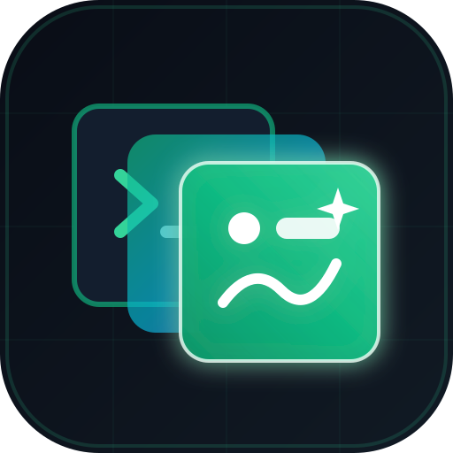

<p align="center">
  
</p>

<h1 align="center">Akasha</h1>

<p align="center">
  <strong>Open-Source Live Web Artifacts for CLI Coding Agents</strong><br>
  <em>Project terminal sessions from Claude Code, OpenAI Codex CLI, and Antigravity into live, versioned, interactive web artifacts — locally or on your own Cloud Hub.</em>
</p>

<p align="center">
  <a href="README.md">English</a> | <a href="README.zh-CN.md">简体中文</a>
</p>

<p align="center">
  <a href="https://github.com/VOD-Studio/akasha-artifacts/actions/workflows/ci.yml"></a>
  <a href="https://github.com/VOD-Studio/akasha-artifacts/releases"></a>
  <a href="LICENSE"></a>
</p>

---

> _"In Sumeru, the Akasha Terminal projects knowledge directly into the user's vision as an interactive holographic canvas."_

**Akasha** brings the power of **Claude Code Artifacts** and **`<antArtifact>` live sandboxes** to **every CLI and IDE coding agent** — including **Antigravity (AGY)**, **OpenAI Codex CLI**, **Claude Code**, **Gemini CLI**, and **Aider** — without locking your private codebase into a proprietary SaaS cloud.

---

## Why Akasha?

Terminal-based coding agents excel at editing files and running shell commands, but reading 800-line pull request diffs, tracking multi-step incident timelines, or exploring session data inside a monochrome terminal is painful.

Anthropic's official _Claude Code Artifacts_ solved this by publishing live web pages from a terminal session, but it comes with three hard limitations:

1. **Vendor & SaaS Lock-in**: Exclusive to Claude Code and requires uploading session payloads to `claude.ai` (restricted to paid Team/Enterprise tiers).
2. **One-Way Read-Only Snapshots**: Official artifacts have no feedback bridge—clicking "Approve" or annotating a diff line in the browser cannot wake up or instruct your CLI agent.
3. **Zero Pre-Built Engineering Primitives**: Models must hand-roll hundreds of lines of boilerplate UI from scratch on every turn.

**Akasha removes all three barriers:**

| Feature                   | Official Claude Code Artifacts     | Akasha (`VOD-Studio/akasha-artifacts`)                                                                       |
| :------------------------ | :--------------------------------- | :----------------------------------------------------------------------------------------------------------- |
| **Supported Agents**      | Claude Code only                   | **Antigravity, Codex CLI, Claude Code, Cursor, Gemini CLI, Aider** (via MCP & CLI)                           |
| **Hosting & Privacy**     | Mandatory `claude.ai` cloud upload | **Dual-Mode**: `localhost` zero-config daemon **+ Self-Hosted Cloud Hub** (Docker / Cloudflare / Vercel)     |
| **Live In-Place Updates** | Yes                                | **Yes** — full version publishing (`v1..vn`) **+ zero-flicker JSON state streaming (`artifact_push_state`)** |
| **Engineering UI Kit**    | Raw HTML/React from scratch        | **Built-in `@akasha/kit`**: `<PRWalkthrough />`, `<LiveTimeline />`, `<OptionCompare />`, `<DataStory />`    |
| **Interaction Direction** | One-way (Read-only capture)        | **Two-way HITL**: inline diff comments, plan approvals, and option selections route back to the CLI agent    |

---

## Core Capabilities

### 1. Live, In-Place Updates (`artifact_publish` & `artifact_push_state`)

As your coding agent works through a task in the terminal, the open Akasha page updates dynamically in real time:

- **Versioned Snapshots (`v1, v2, v3...`)**: Every structural update creates an immutable version at the same URL with instant time-travel diffing.
- **Incremental State Streaming**: For long-running tasks (incident investigation, test suites, database migrations), the agent pushes lightweight JSON patches (`{ step: 3, status: "verified" }`) via WebSocket without rewriting the React component.

### 2. Five High-Frequency Engineering Templates (`@akasha/kit`)

Akasha pre-bundles an engineering component kit inside its sandbox so agents can render rich visual interfaces with minimal tokens:

- **Interactive PR Walkthroughs (`pr-walkthrough`)**: Annotated side-by-side or unified diffs with architectural walkthrough chapters and call-graph highlights.
- **Live Investigation & Task Timelines (`live-timeline`)**: Real-time status boards and release checklists that auto-check as the agent executes commands.
- **Side-by-Side Architecture Comparisons (`option-compare`)**: Compare multiple implementation proposals with live previews and a one-click _"Select Option & Notify Agent"_ button.
- **Session Data Stories & Dashboards (`data-story`)**: Turn SQL queries, logs, and MCP data pulled during a session into filterable charts and tables.
- **Sandboxed React / HTML / Mermaid / SVG (`react`, `html`, `mermaid`, `svg`)**: Full Tailwind CSS v4, Lucide icons, Recharts, and Shiki syntax highlighting out of the box.

### 3. Local-First + Cloud Hub Dual-Mode Architecture

- **Local Daemon Mode**: Instant `http://localhost:4321/a/:id` preview with zero external dependencies.
- **Self-Hosted Cloud Hub**: Deploy to your own domain (`https://akasha.your-team.dev/a/:id`) via a single Docker image or serverless Cloudflare Workers (Durable Objects + D1 + R2).
  - **Origin-Isolated Sandbox**: Untrusted AI-generated HTML/React runs in a dedicated sandbox origin (`*.sandbox.your-team.dev`) with strict CSP headers to prevent cookie/token exfiltration.
  - **Visibility Scopes**: `private` (creator & signed token), `team` (SSO / GitHub OAuth), or `public`.
  - **Live + Async Feedback Queue**: When your CLI is online (`● Live with Agent`), reviewer approvals wake the agent immediately. When your laptop is closed (`○ Snapshot`), teammate annotations are queued in the Cloud Hub and pulled automatically on your next session.

---

## Architecture


---

## Quick Start

### 1. Connect to Your Coding Agent (MCP)

#### Antigravity (AGY) / Claude Code / Codex CLI

Add Akasha to your MCP configuration:

```json
{
  "mcpServers": {
    "akasha": {
      "command": "npx",
      "args": ["-y", "akasha-artifacts", "mcp"],
      "env": {
        "AKASHA_HUB_URL": "http://localhost:4321"
      }
    }
  }
}
```

Or with Claude Code CLI:

```bash
claude mcp add akasha -- npx -y akasha-artifacts mcp
```

### 2. Cloud Hub Deployment (Self-Hosted)

```bash
# Single-container Docker deployment (SQLite by default, Postgres/S3 optional)
docker run -d \
  --name akasha-hub \
  -p 4321:4321 \
  -v ./akasha-data:/data \
  ghcr.io/vod-studio/akasha-artifacts:latest
```

Authenticate your local CLI with your team's Cloud Hub:

```bash
npx akasha-artifacts login --hub https://akasha.your-team.dev
```

---

## MCP Tools Reference

| Tool                      | Description                                                                                                                                                                |
| :------------------------ | :------------------------------------------------------------------------------------------------------------------------------------------------------------------------- |
| `artifact_publish`        | Create or update a versioned artifact (`react`, `html`, `markdown`, `mermaid`, `pr-walkthrough`, `live-timeline`, `option-compare`, `data-story`) and return its live URL. |
| `artifact_push_state`     | Push a zero-flicker incremental JSON state patch to an open artifact page in real time without rewriting the component code.                                               |
| `artifact_await_feedback` | Render a reviewable artifact and suspend until the user clicks _Approve_ or submits structured inline feedback in the browser.                                             |
| `artifact_pull_feedback`  | Pull queued asynchronous teammate comments and review decisions from the Cloud Hub.                                                                                        |

---

## Development

Requirements: **Node.js 24+** and **pnpm 10+**.

```bash
make install   # Install dependencies with frozen lockfile
make lint      # Run Biome check, TypeScript typecheck, and commit lint
make test      # Run Vitest unit tests
make build     # Compile TypeScript to dist/
```

---

## License

[MIT](LICENSE) © [VOD-Studio](https://github.com/VOD-Studio)
