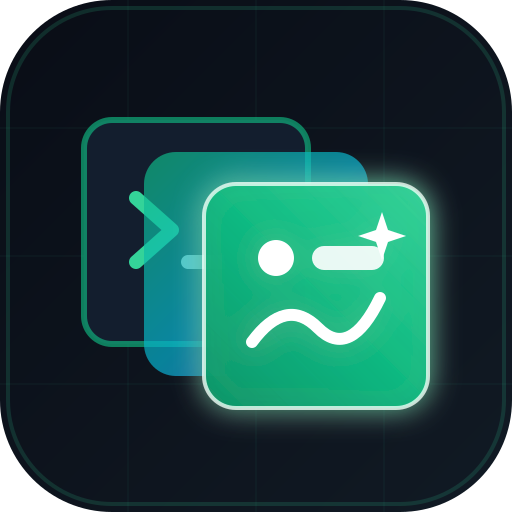
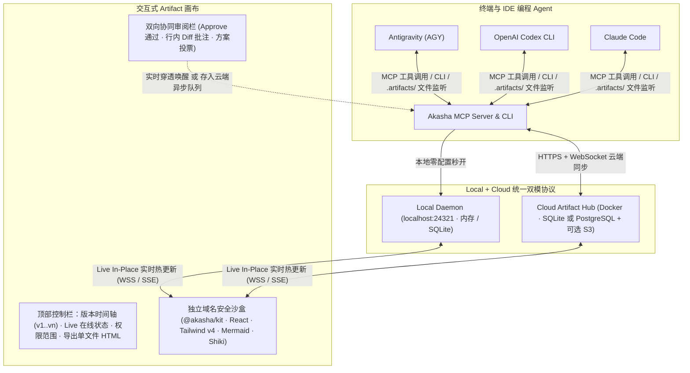

<p align="center">
  
</p>

<h1 align="center">Akasha (虚空) — Interactive Artifacts for Coding Agents</h1>

<p align="center">
  <em>uh-KAH-shuh · [əˈkɑːʃə] · 梵语与须弥设定中“将知识与推演直接投射为可见全息形态的虚空终端”</em>
</p>

<p align="center">
  <strong>面向 CLI 编程 Agent 的开源实时交互式 Web Artifact 引擎</strong><br>
  <em>将 Claude Code、OpenAI Codex CLI 与 Antigravity 的终端会话实时投射为可交互、可回溯版本、支持本地与私有云部署的 Web 画布。</em>
</p>

<p align="center">
  <a href="README.md">English</a> | <a href="README.zh-CN.md">简体中文</a>
</p>

<p align="center">
  <a href="https://github.com/VOD-Studio/akasha-artifacts/actions/workflows/ci.yml"></a>
  <a href="https://github.com/VOD-Studio/akasha-artifacts/releases"></a>
  <a href="LICENSE"></a>
</p>

---

> _“在须弥，虚空终端（Akasha Terminal）连接知识中枢，将推演、图纸与实时情报直接投射为眼前的全息交互界面。”_

**Akasha** 将 **Claude Code Artifacts** 与 **`<antArtifact>` 实时沙盒** 的体验带给**所有主流 CLI 与 IDE 编程 Agent** —— 包括 **Antigravity (AGY)**、**OpenAI Codex CLI**、**Claude Code**、**Gemini CLI** 与 **Aider** —— 既支持本地 `localhost` 零配置秒开，也支持一键私有云部署（Cloud Hub），无需将私有代码库上传至第三方黑盒 SaaS。

---

## 为什么选择 Akasha？

终端编程 Agent 擅长改代码与跑命令，但在黑底白字的命令行里阅读几百行的 PR Diff、追踪多步骤事故排查时间线、或查看会话拉取的数据报表依然非常低效。

Anthropic 官方的 _Claude Code Artifacts_ 允许从 CLI 会话生成实时网页，但它存在三大硬伤：

1. **绑定单一厂商与公有云**：仅限 Claude Code 使用，且必须将代码与会话数据上传至 `claude.ai` 云端（仅限付费 Team/Enterprise 订阅）。
2. **纯单向静态快照（无后端回传）**：官方明确其为无后端的单向页面 —— 你在网页上点击“通过”、选择方案或给某行代码写批注，**无法将指令传回终端里的 Agent**。
3. **缺乏预置工程原语**：每次都要模型从零手写几百行 React/HTML 样板代码，费 Token 且样式质量不稳定。

**Akasha 彻底解决了以上三个痛点：**

| 维度             | Claude Code 官方 Artifacts      | Akasha (`VOD-Studio/akasha-artifacts`)                                                                |
| :--------------- | :------------------------------ | :---------------------------------------------------------------------------------------------------- |
| **兼容 Agent**   | 仅限 Claude Code                | **Antigravity / Codex CLI / Claude Code / Cursor / Gemini CLI / Aider**（通过 MCP 与 CLI）            |
| **部署与隐私**   | 强制上传 `claude.ai` 官方公有云 | **Local + Cloud 双模**：本地 `localhost` 零配置秒开 **+ 团队私有云部署**（Docker）                    |
| **实时原地更新** | 支持                            | **支持** —— 整页版本发布（`v1..vn`）**+ 零闪烁 JSON 状态流式增量推送（`artifact_push_state`）**       |
| **工程组件原语** | 模型每次从零手写页面            | **内置 `@akasha/kit`**：`<PRWalkthrough />`、`<LiveTimeline />`、`<OptionCompare />`、`<DataStory />` |
| **交互方向**     | 单向浏览（只读快照）            | **双向人机协同（HITL）**：行内 Diff 批注、方案投票、审批按钮直接唤醒或回传给 CLI Agent                |

---

## 核心特性

### 1. 实时原地热更新（`artifact_publish` & `artifact_push_state`）

随着终端里的 Agent 推进任务，浏览器中打开的 Akasha 页面会实时同步演进：

- **同链接多版本时间轴（`v1, v2, v3...`）**：每次结构性更新都会在同一 URL 下生成新版本快照，支持一键切换与对比。
- **增量状态流推送（无需重写代码）**：在跑测试、排查线上故障或执行耗时迁移时，Agent 只需调用 `artifact_push_state` 推送轻量 JSON 补丁（如 `{ step: 3, status: "verified" }`），网页上的时间线与图表即可毫秒级零闪烁更新。

### 2. 内置 5 大高频工程模板库（`@akasha/kit`）

沙盒环境预置专为软件工程打磨的高颜值组件原语，让 Agent 用极少 Token 构建专业级交互页面：

- **交互式 PR 走查（`pr-walkthrough`）**：带架构导读章节、Shiki 语法高亮、调用链说明与行内批注的代码审查页面，发一个链接即可让团队看懂大型 PR。
- **实时排查与任务看板（`live-timeline`）**：随 Agent 执行命令自动打勾、追加日志证据与耗时统计的实时状态板。
- **多方案并排交互对比（`option-compare`）**：将多个架构或实现方案并排展示，支持在网页上一键点击“采用方案 B 并通知 Agent”。
- **会话数据故事与仪表盘（`data-story`）**：把会话中通过 SQL、脚本或 MCP 拉取的数据直接转化为可筛选、可排序的图表看板。
- **自由 React / HTML / Mermaid / SVG 画布（`react`, `html`, `mermaid`, `svg`）**：开箱预置 Tailwind CSS v4、Lucide 图标、Recharts 与 Mermaid 交互图。

### 3. 本地优先 + 团队云端（Local + Cloud Hub）双模架构

- **本地模式（Local Daemon）**：零外部依赖，本机 `http://localhost:24321/a/:id` 即刻预览。
- **团队私有云模式（Cloud Hub）**：支持单 Docker 镜像私有化部署，生成团队持久化链接（如 `https://akasha.your-team.dev/a/:id`）。
  - **双域名沙盒安全隔离（Origin Isolation）**：不可信的制品 HTML/React 运行在另一个注册域名下，受独立的严格 CSP 约束。
  - **三级权限控制**：`private`（仅创建者与签名链接）、`team`（团队 SSO / GitHub OAuth 登录可见）、`public`（公开只读分享）。
  - **在线实时 + 离线异步反馈队列**：当开发者的 CLI 在线时（`● Live with Agent`），同事在网页上的评审操作毫秒级穿透回终端唤醒 Agent；当开发者合上电脑离线时（`○ Snapshot`），同事的行内批注自动存入云端队列，下次 Agent 启动时一键拉取处理。

---

## 架构设计



---

## 路线图与实现状态

> Akasha 正在积极开发中。完整规范见[总体设计说明](docs/design/architecture.md)、[领域术语表](CONTEXT.md)、[服务端选型 ADR-0001](docs/adr/0001-server-runtime-typescript-hono.md) 与 [v1 PRD (#5)](https://github.com/VOD-Studio/akasha-artifacts/issues/5)。

| 里程碑 | 范围                                                                                                                     | 状态   |
| :----- | :----------------------------------------------------------------------------------------------------------------------- | :----- |
| **M0** | Monorepo 骨架、`@akasha/ui` 外壳组件库、`@akasha/protocol`（zod + JSON Schema）、不可变版本模型与 RFC 6902 状态流        | 已完成 |
| **M1** | 整机单例 Local Daemon（Hono + SQLite）、WS 断线补齐、MCP 工具、`check` 校验门禁、热更新保态沙盒、多项目外壳工作台        | 已完成 |
| **M2** | L1 元素指认与选中框、`ReviewRound` 草稿/整轮提交防打断回路、`receipt/ack`、多 Harness Hooks 与 Skills、运行报错修复回路  | 已完成 |
| **M3** | `@akasha/kit` schema 引擎与 L2 属性面板、`artboard` / `document` / `verify`、L3 分栏代码编辑、`.artifacts/` 原生文件模式 | 已完成 |
| **M4** | L4 可视化直改（AST 回写与撤销）、作用域存储、PR 走查与数据故事模板                                                       | 已完成 |
| **M5** | Docker 单容器 Cloud Hub 自托管（OAuth、可见性权限、离线反馈队列、本机访问优先直连 Daemon）                               | 已完成 |
| **M6** | 可选的 Cloudflare Workers 部署（[#29](https://github.com/VOD-Studio/akasha-artifacts/issues/29)）                        | 后置   |

多人同时编辑尚未实现，独立于 Hub 的部署方式。

---

## 快速开始

> [!NOTE]
> `akasha serve` 启动本地工作台、MCP 后端与隔离沙盒。打开 `artboard` 制品即可对比各自有独立尺寸的画板；在页面与画板导航中可切换位置，或复制保留当前版本范围的页面链接。HTML 和 React 制品默认使用一张画板，保留批注抽屉与静态节点直改。Kit 还提供 `pr-walkthrough` 与 `data-story`。以下 Hub 部署方式需要自备域名和 OAuth App。

### 1. 接入你的编程 Agent（MCP 与 Hooks — M1/M2）

#### 一键安装多端插件（Claude Code / Antigravity / Codex CLI / Cursor）

```bash
# 幂等安装 MCP 配置、对应客户端 Hooks 与轻量化 Skills
npx -y akasha-artifacts install --harness claude-code
# 自检 Node.js 版本、Daemon 连通性、端口冲突与插件安装完整性
npx -y akasha-artifacts doctor --harness claude-code
```

#### 手动配置 MCP（Antigravity / Claude Code / Codex CLI）

在 Agent 的 MCP 配置文件中添加 Akasha：

```json
{
  "mcpServers": {
    "akasha": {
      "command": "npx",
      "args": ["-y", "akasha-artifacts", "mcp"],
      "env": {
        "AKASHA_HUB_URL": "http://localhost:24321"
      }
    }
  }
}
```

或使用 Claude Code 命令行一键挂载：

```bash
claude mcp add akasha -- npx -y akasha-artifacts mcp
```

### 2. 团队云端部署（Docker）

Docker 是 Cloud Hub 的默认部署方式，不需要 Cloudflare。按[单镜像部署指南](deploy/docker/README.md)配置[环境变量](deploy/docker/.env.example)。默认 SQLite，可选 PostgreSQL 和 S3 兼容对象存储。生产外壳与沙盒必须使用不同的注册域名。

先登录，再将 MCP 接到团队 Hub：

```bash
npx akasha-artifacts login --hub https://akasha.example.com
npx akasha-artifacts mcp --hub https://akasha.example.com
```

本机已绑定该 Hub 且持有同一制品时，打开 Hub 链接会优先进入本机工作台。

### 3. 制品作用域存储

```js
await window.akasha.storage.set('layout', { compact: true })
const layout = await window.akasha.storage.get('layout')
const keys = await window.akasha.storage.list({ scope: 'shared', prefix: 'team:' })
await window.akasha.storage.delete('layout')
```

默认 `private` 按制品和用户隔离。`shared` 对该制品的查看者可读、编辑者可写。每个作用域最多 128 个键、总计 64 KiB；单键不超过 128 字节，单个 JSON 值不超过 16 KiB。不存在的键返回 `null`。存储请求由外壳转发，沙盒不发起网络请求。

---

## MCP 工具清单

> `@akasha/protocol` 定义的全部 10 个 MCP 工具均已在本地 Daemon 与 stdio MCP 服务落地（**M1 + M2**）。

| 工具名称                  | 里程碑 | 功能说明                                                                                 |
| :------------------------ | :----- | :--------------------------------------------------------------------------------------- |
| `artifact_publish`        | M1     | 新建或整页更新带版本历史的 Artifact（更新须带 `baseVersion`），返回稳定 `publicId` URL。 |
| `artifact_update`         | M1     | 按 `old_str → new_str` 精确单处匹配做增量修改，显著节省模型输出 Token。                  |
| `artifact_check`          | M1     | 发布前静态校验门禁（语法、白名单依赖、模板 schema、`blockId` 唯一性）。                  |
| `artifact_spec`           | M1     | 按需拉取指定 Artifact 类型的完整写作规范与依赖白名单。                                   |
| `artifact_push_state`     | M1     | 向 Artifact 的 `StateStream` 推送原子 RFC 6902 JSON Patch，无需重写源码即可零闪烁更新。  |
| `artifact_get`            | M1     | 读取最新或历史版本源码、状态快照与评审轮次（用于在 `409` 冲突后合并）。                  |
| `artifact_read_handoff`   | 工作区 | 在接收方 CLI 项目的读取权限内取回移交的固定版本、画板或图层。                            |
| `artifact_pull_feedback`  | M2     | 非阻塞拉取结构化反馈与已提交轮次；仅完整拉取时签发消费回执 `receipt`。                   |
| `artifact_ack_feedback`   | M2     | 凭 `receipt` 确认反馈已消费，并可将已处理线程标记为 `resolved`。                         |
| `artifact_await_feedback` | M2     | 在无异步 Hook 唤醒的客户端中长轮询等待浏览器反馈（单次最长 50 秒）。                     |
| `artifact_record_verdict` | M2     | 将用户在终端口头表达的选择或 Pass/Reject/Waive 验收裁决回写至对应评审轮次。              |

---

## 本地开发

环境要求：**Node.js 24+** 与 **pnpm 10+**。

```bash
make install   # 安装锁定依赖
make lint      # 运行 Biome 检查、架构依赖方向检查、TypeScript 类型检查与提交规范校验
make typecheck # 单独运行 TypeScript 类型检查
make test      # 运行工作区 Vitest 单元测试
make build     # 构建全部工作区包并导出协议 JSON Schema
make dev       # 启动全栈开发：前端与沙盒热更新，后端自动重启
make serve     # 构建并运行完整应用，不监听源码
```

日常开发运行 `make dev`。看到 `开发 Daemon 已就绪` 后，打开 [http://127.0.0.1:5173](http://127.0.0.1:5173)。该命令会启动工作台、独立的开发沙盒（`5174`）和本地 Daemon。前端和沙盒会热更新；后端构建成功后自动重启，不会使浏览器登录失效。

验收构建版时运行 `make serve`，打开 [http://127.0.0.1:24321](http://127.0.0.1:24321)，或使用 Daemon 输出的端口。两个命令使用同一 `AKASHA_HOME` 时，切换前先停止正在运行的命令。需要为开发环境指定不同的 API 端口时，例如运行 `AKASHA_DEV_DAEMON_PORT=24323 make dev`。

---

## 开源协议

[MIT](LICENSE) © [VOD-Studio](https://github.com/VOD-Studio)
