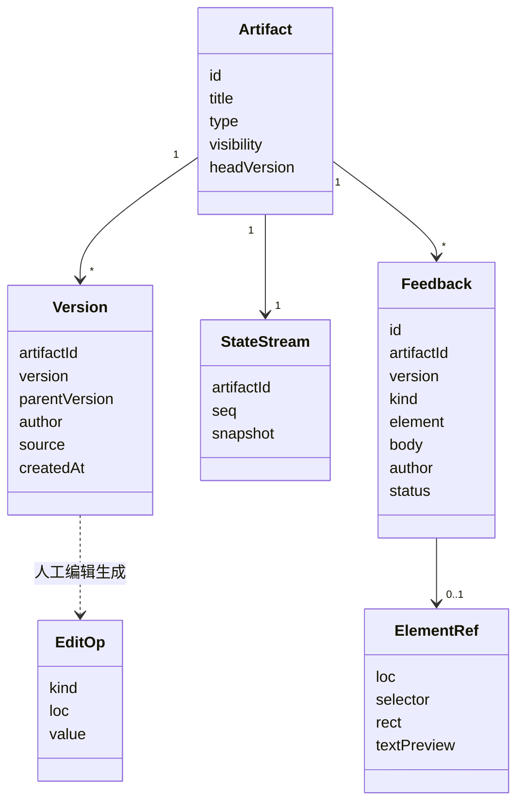
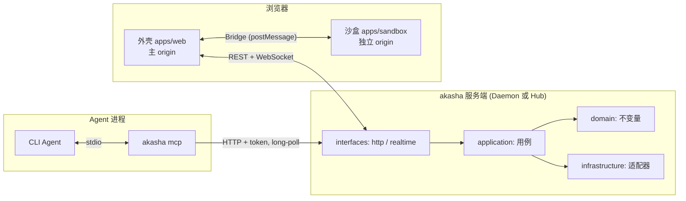
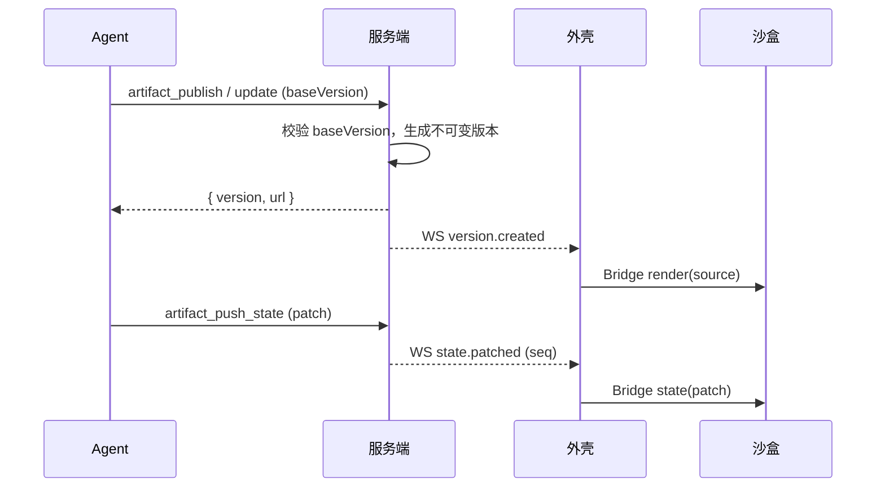
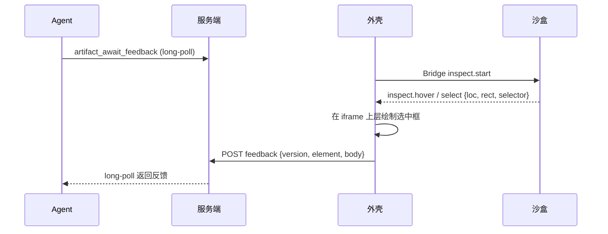
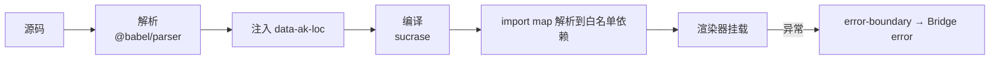
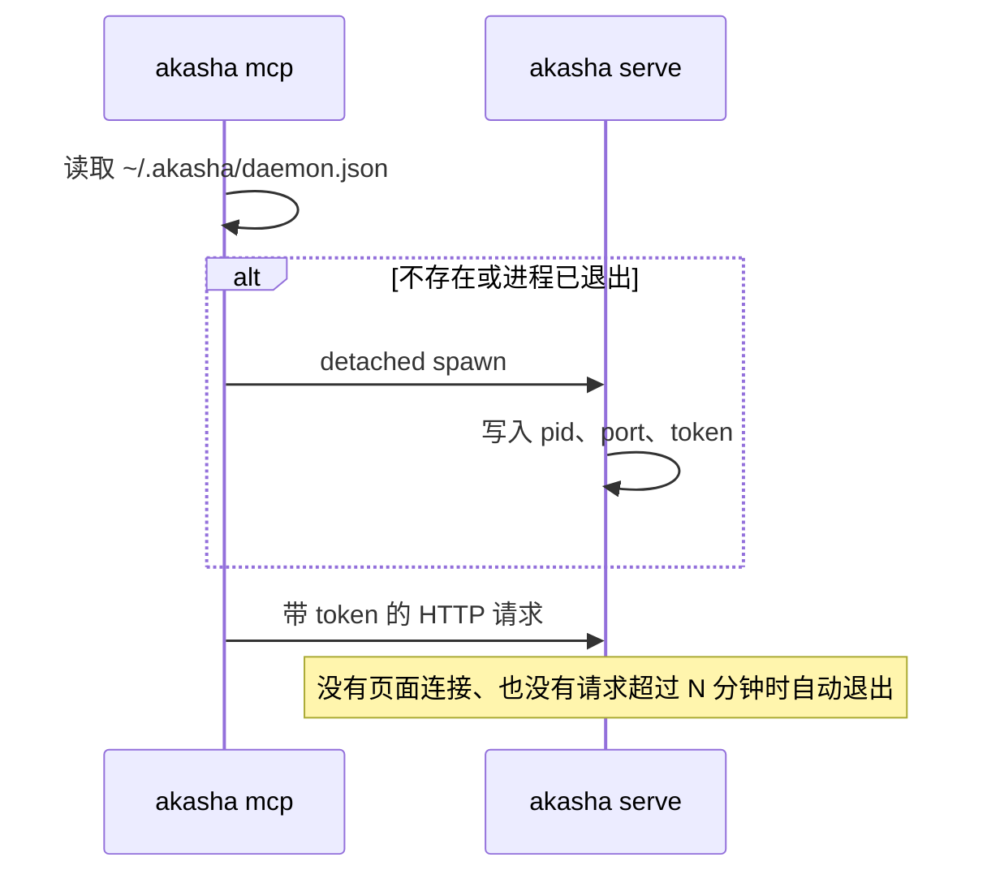

# Akasha 设计说明

本文是 Akasha 的总体设计依据。实现、评审和拆分任务时都以本文为准；与本文冲突的改动，要么先修改本文，要么新增一篇 ADR 说明偏离的理由。术语定义见 [CONTEXT.md](../../CONTEXT.md)，关键技术选型见 [docs/adr](../adr/)。

- [1. 要解决的问题](#1-要解决的问题)
- [2. 设计原则](#2-设计原则)
- [3. 领域模型](#3-领域模型)
- [4. 系统架构](#4-系统架构)
- [5. 协议设计](#5-协议设计)
- [6. 版本与并发模型](#6-版本与并发模型)
- [7. 沙盒运行时](#7-沙盒运行时)
- [8. 编辑能力分层](#8-编辑能力分层)
- [9. 人机反馈回路](#9-人机反馈回路)
- [10. 部署形态](#10-部署形态)
- [11. 安全模型](#11-安全模型)
- [12. 代码组织](#12-代码组织)
- [13. 扩展点](#13-扩展点)
- [14. 非目标](#14-非目标)

---

## 1. 要解决的问题

CLI 编程 Agent 改文件、跑命令很快，但它产出的大量信息在终端里很难阅读和协作：上百行的 diff 走查、多步骤的排障时间线、几个方案的对比、会话中查询到的数据。人想对这些内容做出反应，比如「这一行不对」「选方案 B」「这个按钮改成红色」，只能退回终端，用文字重新描述一遍位置和意图。

Akasha 要提供的是：

1. **投影**：Agent 把会话中的信息发布成一个有版本、能实时更新的网页。
2. **回路**：人在网页上的操作（指认、批注、批准、修改）以结构化的形式回到 Agent。
3. **自主**：整条链路可以完全跑在本机，也可以部署在团队自己的服务器上，任何 CLI Agent 都能接入。

## 2. 设计原则

以下原则按优先级排列。两条原则冲突时，排在前面的优先。

### P1 交互即上下文

人在网页上的每一次有效操作，都必须能转换成 Agent 可以直接使用的结构化上下文：选中了什么元素、对应源码哪一行、意图是什么、基于哪个版本。

- 反例：只把「用户点了 Approve」发回去，不说明批准的是哪个版本。
- 推论：所有反馈都必须带上 `artifactId`、`version` 和可选的 `ElementRef`。

### P2 人与 Agent 平权，人的修改不会被静默覆盖

人和 Agent 都是 Artifact 的作者，各自产生的版本地位相同。任何写入都要声明自己基于哪个版本（`baseVersion`），落后的写入会被拒绝，并收到需要合并的差异。

- 推论：版本历史是一张有向无环图（DAG），每个版本记录 `parentVersion` 和 `author`。

### P3 协议优先，实现可替换

系统的稳定部分是协议，不是实现。MCP 工具、HTTP API、WebSocket 事件、外壳与沙盒之间的 Bridge 消息，全部由 `@akasha/protocol` 中的 zod schema 定义，并导出 JSON Schema / OpenAPI。

- 推论：协议包附带一组只通过 HTTP / WS 访问的契约测试。任何服务端实现，不论用什么语言，通过这组测试就算兼容。
- 推论：协议用 `/api/v1` 和消息内的 `v` 字段标明版本；破坏性变更必须升主版本。

### P4 本地优先，云端同构

本地 Daemon 和云端 Hub 是**同一套代码**，区别只在装配时注入的适配器（存储、实时通道、鉴权、Blob）。本地模式零配置，不依赖任何外部服务。

- 推论：领域层和应用层不能出现「当前是否是云端」这类分支判断。差异只能体现为不同的适配器。

### P5 不可信代码默认隔离

模型生成的 HTML / JS 一律视为不可信。它只能在独立 origin 的 iframe 中运行，拿不到外壳的任何凭据，也不能访问网络。外壳与沙盒之间只能通过经过校验的 Bridge 消息通信。

- 推论：沙盒内不绘制任何属于外壳的 UI（选中框、手柄、面板），只回传坐标和元数据。

### P6 增量优于重写

模型输出的 token 是成本，也是延迟。系统要优先提供增量操作：

| 变化                         | 首选操作                                         |
| :--------------------------- | :----------------------------------------------- |
| 运行时数据变了（进度、状态） | `artifact_push_state`：只推 JSON Patch，不改代码 |
| 代码的局部修改               | `artifact_update`：`old_str → new_str` 替换      |
| 结构性重做                   | `artifact_publish`：整体发布                     |

### P7 用约束换确定性

沙盒内的依赖是固定的白名单，并预先打包好；工具描述会明确告诉模型有哪些库可用。高频场景用 `@akasha/kit` 模板加 props schema 实现，模型只需要填数据。

- 收益：渲染不需要联网安装依赖，结果可预测，所需 token 少，也让 L2 属性面板成为可能。

### P8 渐进能力，失败可降级

编辑能力分成 L0–L4 五层（见第 8 节），每一层都能单独交付和使用。上层能力不适用时，必须自动退回下层，不能报错或卡住。比如动态渲染出来的节点无法可视化直改，就退回为「批注并交给 Agent 修改」。

### P9 框架只放在最外层

HTTP 框架、UI 框架、ORM 只出现在接口层和适配器层。领域层是纯 TypeScript，不 import 任何框架。替换框架的成本应当只限于这一层。

---

## 3. 领域模型



| 概念            | 不变量                                                                                                                                                               |
| :-------------- | :------------------------------------------------------------------------------------------------------------------------------------------------------------------- |
| **Artifact**    | `id` 由 Agent 指定、全局唯一且不会改变；`headVersion` 只能前进                                                                                                       |
| **Version**     | 一经创建就不能修改；`version` 在同一 Artifact 内单调递增；`author` 为 `agent:<session>` 或 `human:<user>`                                                            |
| **StateStream** | 运行时状态与代码版本分开管理；每个补丁带单调递增的 `seq`，可以从任意 `seq` 回放；补丁格式为 JSON Patch（RFC 6902）                                                   |
| **Feedback**    | 必须绑定到具体的 `version`；`kind` 取值为 `comment`、`approve`、`request_changes`、`vote`、`edit`、`runtime_error`；`status` 为 `pending`、`delivered` 或 `resolved` |
| **ElementRef**  | 定位优先级：`loc`（源码位置）> `selector`（CSS 选择器）> `textPreview`（文本片段）。拿不到 `loc` 时退回后两者                                                        |
| **EditOp**      | 只能作用于静态源码节点；`kind` 取值为 `text`、`className`、`attr`、`move`、`remove`                                                                                  |

运行时状态之所以和版本分开，是因为长任务会产生成百上千次状态变化。如果每次都生成一个代码版本，版本历史就失去了意义；而状态补丁带 `seq`，同样可以回溯到任意时刻。

---

## 4. 系统架构



| 组件           | 职责                                               | 不负责                        |
| :------------- | :------------------------------------------------- | :---------------------------- |
| **akasha mcp** | 把 MCP 工具调用翻译成 HTTP 请求；需要时拉起 Daemon | 不保存任何状态                |
| **服务端**     | 版本、状态流、反馈队列、实时广播、鉴权、源码改写   | 不执行 Artifact 代码          |
| **外壳**       | 时间线、批注、编辑器、选中框、属性面板             | 不执行 Artifact 代码          |
| **沙盒**       | 编译与渲染 Artifact、命中测试、报告错误            | 不持有任何凭据，不绘制外壳 UI |

### 关键链路

**发布与实时更新**



**指认与反馈**



---

## 5. 协议设计

协议的唯一事实源是 `@akasha/protocol`。以下内容是设计意图，字段细节以代码为准。

### 5.1 MCP 工具

| 工具                      | 输入                                                 | 输出                        | 说明                                                             |
| :------------------------ | :--------------------------------------------------- | :-------------------------- | :--------------------------------------------------------------- |
| `artifact_publish`        | `id, title, type, source, baseVersion?, visibility?` | `{ version, url }`          | 新建或整体替换。`id` 已存在时必须带 `baseVersion`                |
| `artifact_update`         | `id, baseVersion, edits: [{ old_str, new_str }]`     | `{ version, url }`          | 增量修改。`old_str` 必须在源码中唯一匹配，否则返回带上下文的错误 |
| `artifact_push_state`     | `id, patch (JSON Patch)`                             | `{ seq }`                   | 只更新运行时状态，不生成版本                                     |
| `artifact_await_feedback` | `id, after?, timeoutSec?`                            | `{ status, items, cursor }` | 阻塞等待反馈。超时返回 `pending` 和 `cursor`，模型应继续调用     |
| `artifact_pull_feedback`  | `id?, after?`                                        | `{ items, cursor }`         | 非阻塞拉取，用于离线期间积累的反馈                               |
| `artifact_get`            | `id, version?`                                       | 源码、状态和元数据          | 发生冲突后，用来获取最新内容再合并                               |

工具描述（description）本身就是协议的一部分，必须写清：可用的依赖白名单、kit 模板列表、增量优先的规则（P6）、`await_feedback` 要循环调用的约定。

### 5.2 HTTP 与 WebSocket

- REST 前缀 `/api/v1`，资源包括 `artifacts`、`artifacts/:id/versions`、`artifacts/:id/state`、`artifacts/:id/feedback`、`artifacts/:id/edits`。
- 错误统一为 `{ error: { code, message, details } }`。冲突用 `409 VERSION_CONFLICT`，`details` 中附带 `headVersion` 和对应的 diff。
- WebSocket 按 Artifact 订阅。事件包括 `version.created`、`state.patched`、`feedback.created`、`feedback.updated`、`presence.changed`。每条事件带 `seq`；客户端重连时带上 `lastSeq`，服务端补发之间的事件，无法补发时返回 `resync`。

### 5.3 Bridge（外壳 ↔ 沙盒）

| 方向        | 消息                                                                                         |
| :---------- | :------------------------------------------------------------------------------------------- |
| 外壳 → 沙盒 | `render`、`state`、`inspect.start`、`inspect.stop`、`highlight`、`apply.preview`             |
| 沙盒 → 外壳 | `ready`、`rendered`、`error`、`resize`、`inspect.hover`、`inspect.select`、`storage.request` |

规则：每条消息都带 `v`（协议版本）和 `nonce`（会话标识）。接收方必须校验 `event.origin` 并用 zod 解析消息；校验失败的消息直接丢弃。

---

## 6. 版本与并发模型

1. 每次写入都要带 `baseVersion`。如果 `baseVersion` 等于当前的 `headVersion`，写入成功并生成新版本；否则返回 `409`。
2. 冲突响应中包含从 `baseVersion` 到 `headVersion` 的 diff 及每个版本的作者。Agent 读到人的修改后合并，再基于新的 `headVersion` 重试。
3. 人在网页上产生的 `EditOp`，由服务端在 AST 上应用，生成作者为人的新版本，同时写入一条 `kind=edit` 的 Feedback，让 Agent 知道发生了什么。
4. 状态流（StateStream）不参与版本冲突。补丁总是作用于最新状态；如果版本发生了结构性变化导致补丁路径失效，就丢弃该补丁并返回错误。
5. 回退到历史版本也是一次写入：生成一个内容等于历史版本的新版本，不移动已有版本。

---

## 7. 沙盒运行时

### 7.1 隔离

| 层面   | 要求                                                                                                                                      |
| :----- | :---------------------------------------------------------------------------------------------------------------------------------------- |
| Origin | 本地使用不同端口（外壳 `:4321`，沙盒 `:4322`）。云端必须使用**另一个注册域名**，只换子域名不够，因为同一注册域名下的子域名可能共享 cookie |
| iframe | `sandbox="allow-scripts"`，**不加** `allow-same-origin`                                                                                   |
| CSP    | `default-src 'none'`，脚本和样式只允许沙盒自己的资源，`connect-src 'none'`，`frame-ancestors` 只允许外壳 origin                           |
| 凭据   | 沙盒不接触任何 token；需要持久化时通过 Bridge 请求外壳代办                                                                                |

### 7.2 渲染流水线



- **渲染器**：`html`、`markdown`、`mermaid`、`svg`、`react`，以及各个 kit 模板。渲染器通过注册表接入（见第 13 节）。
- **依赖白名单**：React、Tailwind v4、lucide-react、recharts、shiki、mermaid，以及 `@akasha/kit`。全部预先打包并随沙盒一起分发，运行时不联网。
- **Tailwind**：在沙盒内按需生成样式，支持任意值写法，这样 L4 样式面板就能写回任意类名。
- **状态注入**：通过 `useArtifactState()` hook 读取运行时状态；收到 `state` 消息时只触发数据更新，不重新挂载组件。

### 7.3 错误回路

编译错误和运行时错误都会带着源码位置回传给外壳。外壳显示错误，并提供「交给 Agent 修复」按钮：点击后写入一条 `kind=runtime_error` 的 Feedback，包含错误信息、调用栈和源码片段。

### 7.4 持久化存储

沙盒内提供 `window.akasha.storage`，接口为 `get`、`set`、`delete`、`list`，作用域分为 `private`（仅当前用户）和 `shared`（所有可访问者共享），并有容量上限。调用链是：沙盒 → Bridge → 外壳 → 服务端，沙盒自己不直接联网。

---

## 8. 编辑能力分层

| 层级              | 用户能做什么                                                              | 产出                      | 降级目标 |
| :---------------- | :------------------------------------------------------------------------ | :------------------------ | :------- |
| **L0 查看**       | 渲染、切换版本、对比版本                                                  | —                         | —        |
| **L1 指认与批注** | 点选元素后写批注，或「让 Agent 改这里」；Approve / Request changes / 投票 | Feedback（附 ElementRef） | —        |
| **L2 结构化参数** | 编辑 kit 模板的属性面板                                                   | 状态补丁或 props 修改     | L1       |
| **L3 代码编辑**   | 分栏代码编辑器，实时预览                                                  | 作者为人的新版本          | L1       |
| **L4 可视化直改** | 双击改文字、样式面板、拖拽排序、删除                                      | EditOp → 新版本           | L1       |

**L1 是核心能力，交付优先级最高。** L2 到 L4 都是为了降低人表达意图的成本，任何一层不适用时都退回 L1。

### L4 的约束

- 只有带 `data-ak-loc`、且对应源码是**静态字面量**的节点才可以直改。由表达式、循环或状态生成的内容只能批注。
- 改写使用 recast，保留原有格式，生成的 diff 只涉及被修改的部分。
- 编辑过程中，外壳先通过 `apply.preview` 让沙盒乐观地预览效果；提交后由服务端生成正式版本。
- 每个 EditOp 都可以撤销，撤销本身也是一次写入。

---

## 9. 人机反馈回路

| 场景                   | 机制                                                                                                              |
| :--------------------- | :---------------------------------------------------------------------------------------------------------------- |
| Agent 在线并等待       | `artifact_await_feedback` 走 long-poll。服务端最多挂起 50 秒（低于常见 MCP 客户端的工具超时），超时返回 `pending` |
| Agent 在线但没有等待   | 反馈进入队列，Agent 下次调用 `pull` 或 `await` 时取走                                                             |
| Agent 离线（云端 Hub） | 队列持久化保存；Agent 下次会话启动时拉取                                                                          |
| 外壳上的状态           | 顶栏显示 `● 与 Agent 实时连接` 或 `○ 快照`，让人知道反馈何时会被处理                                              |

反馈的投递语义是「至少一次」：靠 `cursor` 保证不丢；Agent 处理完后把对应反馈标记为 `resolved`。

---

## 10. 部署形态

### 10.1 本地 Daemon



- 存储：`node:sqlite`（数据库文件放在 `~/.akasha/akasha.db`），Blob 放在 `~/.akasha/blobs`。
- 外壳和沙盒的静态资源都打包在 npm 包里，由 Daemon 直接托管。

### 10.2 Cloud Hub

| 形态               | 适配器组合                                                    |
| :----------------- | :------------------------------------------------------------ |
| Docker 单容器      | Node 入口 + SQLite 或 Postgres + 文件系统或 S3 + node-ws      |
| Cloudflare Workers | Worker 入口 + D1 + R2 + Durable Objects（实时通道与多人协作） |

Hub 额外提供：鉴权（GitHub OAuth / 团队 SSO）、可见性（`private` / `team` / `public`）、离线反馈队列，以及 `akasha login` 下发的 CLI 访问令牌。

---

## 11. 安全模型

| 威胁                                      | 对策                                                                 |
| :---------------------------------------- | :------------------------------------------------------------------- |
| 恶意 Artifact 代码窃取凭据                | 独立 origin，不加 `allow-same-origin`，沙盒内不接触任何凭据          |
| 恶意 Artifact 代码外传数据                | CSP `connect-src 'none'`；需要持久化时只能通过 Bridge 代办，并有限额 |
| 用户访问的其他网站调用本地 Daemon（CSRF） | 写接口要求 token 或同源 cookie，并校验 `Origin`                      |
| DNS rebinding 攻击本地 Daemon             | 校验 `Host` 头只能是 `localhost` 或 `127.0.0.1` 加上 Daemon 端口     |
| 伪造 Bridge 消息                          | 校验 `event.origin`、zod 解析消息、比对 `nonce`                      |
| 沙盒嵌入第三方页面                        | `frame-ancestors` 只允许外壳 origin                                  |
| 越权访问团队 Artifact                     | 每个请求都按 visibility 和成员关系鉴权；分享链接使用带签名的 token   |

---

## 12. 代码组织

### 12.1 仓库结构

```
akasha-artifacts/
├── apps/
│   ├── web/                 # 外壳单页应用
│   └── sandbox/             # 沙盒运行时，单独构建，独立 origin
├── packages/
│   ├── protocol/            # zod 契约、JSON Schema 导出、契约测试
│   ├── server/              # 服务端（DDD 分层）
│   ├── mcp/                 # MCP 工具
│   ├── jsx-source/          # 源码位置注入与 EditOp 的 AST 改写
│   ├── kit/                 # 模板组件与 props schema
│   ├── ui/                  # 外壳通用控件与设计 token
│   └── akasha/              # 对外发布的 npm 包（bin: akasha），打包以上全部
├── deploy/{docker,cloudflare}/
├── docs/{design,adr,prd,agents,guides}/
├── test/e2e/                # Playwright 端到端测试
└── CONTEXT.md               # 术语表
```

依赖方向：`protocol` 不依赖任何包。`server` 依赖 `protocol` 和 `jsx-source`；`apps/web` 依赖 `protocol` 和 `ui`；`apps/sandbox` 依赖 `protocol`、`jsx-source` 和 `kit`；`akasha` 负责组装所有包。不允许反向依赖。

### 12.2 服务端分层

```
packages/server/src/
├── domain/          # 不变量：artifact、state、feedback、edit。纯 TS，不做 IO
├── application/     # 用例编排：publish、update、pushState、awaitFeedback、applyEdit
├── infrastructure/  # 适配器：storage/*、blob/*、realtime/*、auth/*
├── interfaces/      # http（Hono 路由）、realtime（WS 编解码）
├── app/             # 手工装配：createLocalContainer、createHubContainer
└── entry/           # node.ts、worker.ts
```

- 领域层定义端口接口（如 `ArtifactRepository`、`RealtimePublisher`），基础设施层负责实现。
- 应用层的用例通过构造参数拿到依赖，便于用内存适配器做单元测试。

### 12.3 外壳分层

```
apps/web/src/
├── routes/      # 文件路由
├── widgets/     # 页面级组合：ArtifactWorkspace、TopBar、InspectorPanel
├── features/    # 用户能力切片：live-sync、version-timeline、element-picker、
│                #   annotations、review-actions、props-panel、code-editor、visual-edit
├── entities/    # 业务实体：artifact、version、feedback、selection
└── shared/      # api、bridge（宿主端）、overlay、lib、config
```

- 依赖只能自上而下：`routes → widgets → features → entities → shared`。
- 服务端数据由 TanStack Query 管理，WebSocket 事件直接写入查询缓存；编辑器的本地状态（工具模式、当前选中元素、撤销栈）由 Zustand 管理。
- `entities/selection` 是指认、批注和直改三个能力共用的核心模型，不属于其中任何一个 feature。

---

## 13. 扩展点

| 扩展点           | 接口                                                    | 例子                      |
| :--------------- | :------------------------------------------------------ | :------------------------ |
| Artifact 类型    | 沙盒渲染器注册表 `registerRenderer(type, renderer)`     | 新增 `notebook`、`slides` |
| Kit 模板         | 组件 + props schema + MCP 工具描述片段                  | 新增 `api-explorer`       |
| 存储             | `ArtifactRepository`、`FeedbackRepository`、`BlobStore` | 新增 MySQL                |
| 实时通道         | `RealtimePublisher` / `RealtimeSubscriber`              | 新增 Redis Pub/Sub        |
| 鉴权             | `AuthProvider`                                          | 新增 OIDC                 |
| 其他语言的客户端 | OpenAPI + 契约测试                                      | Python SDK                |
| 计算密集模块     | 编译成 wasm 的模块，三个运行时共用                      | CRDT、大文件 diff         |

## 14. 非目标

- 不做通用网页托管或建站工具。Artifact 服务于 Agent 会话。
- 不在沙盒里运行任意 npm 包，依赖只来自白名单。
- 不内置大模型调用能力。Artifact 内的智能来自 Agent 回路，而不是页面直接调用模型。
- v1 不支持多人同时编辑同一个 Artifact（属于 M6）。
