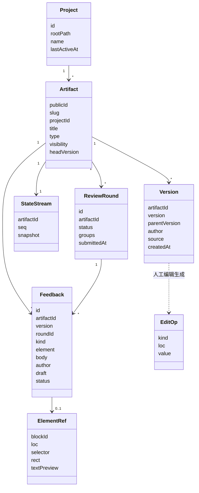
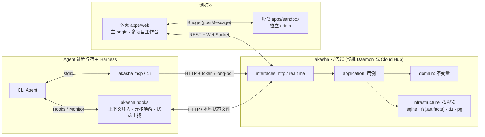
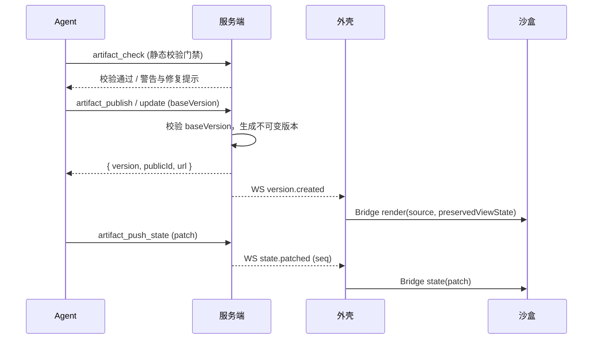
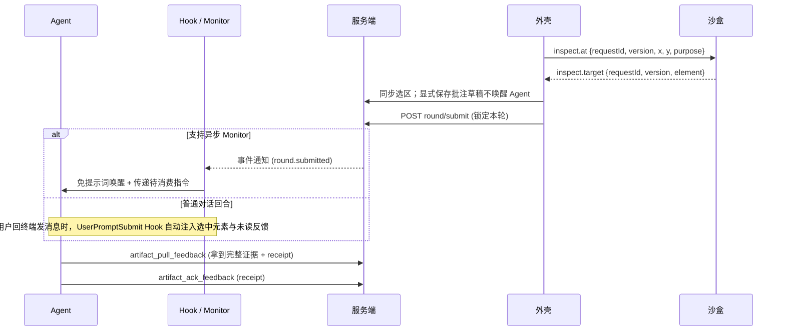
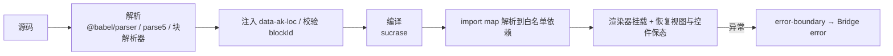
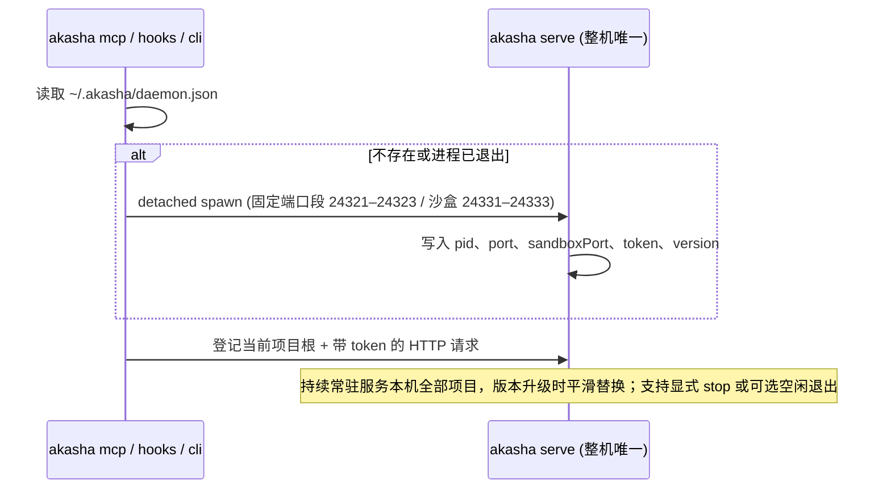

# Akasha 设计说明

本文是 Akasha 的总体设计依据。实现、评审和拆分任务时都以本文为准；与本文冲突的改动，要么先修改本文，要么新增一篇 ADR 说明偏离的理由。术语定义见 [CONTEXT.md](../../CONTEXT.md)，关键技术选型见 [docs/adr](../adr/)。

- [1. 要解决的问题](#1-要解决的问题)
- [2. 设计原则](#2-设计原则)
- [3. 领域模型](#3-领域模型)
- [4. 系统架构](#4-系统架构)
- [5. 协议设计](#5-协议设计)
- [6. 版本与并发模型](#6-版本与并发模型)
- [7. 沙盒运行时](#7-沙盒运行时)
- [8. 编辑能力分层](#8-编辑能力分层)
- [9. 人机反馈回路](#9-人机反馈回路)
- [10. 部署形态](#10-部署形态)
- [11. 安全模型](#11-安全模型)
- [12. 代码组织](#12-代码组织)
- [13. 扩展点](#13-扩展点)
- [14. 非目标](#14-非目标)

---

## 1. 要解决的问题

CLI 编程 Agent 改文件、跑命令很快，但它产出的大量信息在终端里很难阅读和协作：多方案界面对比、长篇架构设计稿、上百行的 diff 走查、多步骤排障时间线、会话查询数据，以及交付前的视觉与行为验收。人想对这些内容做出反应——「选方案 B」「这一段有问题」「这个按钮改红」「验收不通过」——只能退回终端，用文字重新描述位置和意图。

Akasha 要提供的是：

1. **投影**：Agent 把会话中的决策与产出发布为有版本、可实时更新的网页。
2. **回路**：人在网页上的指认、批注、批次选择、验收裁决与直接修改，以结构化上下文无摩擦地回到 Agent。
3. **自主**：整条链路全栈开源，可零配置运行在本机，也可私有化部署在团队服务器上，任何 CLI Agent 都能接入。

## 2. 设计原则

以下原则按优先级排列。两条原则冲突时，排在前面的优先。

### P1 交互即上下文

人在网页上的每一次有效操作，都必须能转换成 Agent 可以直接使用的结构化上下文：归属哪个项目与 Artifact、基于哪个版本、指向哪个块或元素、意图是什么。

- 反例：只把「用户点了 Approve」发回去，不说明批准的是哪个版本或哪组方案。
- 推论：所有反馈都必须带上 `artifactId`、`version` 和可选的 `ElementRef` / `roundId`。

### P2 人与 Agent 平权，人的修改不会被静默覆盖

人和 Agent 都是 Artifact 的作者，各自产生的版本地位相同。任何写入都要声明自己基于哪个版本（`baseVersion`），落后的写入会被拒绝，并收到需要合并的差异。

- 推论：版本历史是一张有向无环图（DAG），每个版本记录 `parentVersion` 和 `author`。

### P3 协议优先，实现可替换

系统的稳定部分是协议，不是实现。MCP 工具、CLI 机器输出、HTTP API、WebSocket 事件、外壳与沙盒之间的 Bridge 消息，全部由 `@akasha/protocol` 中的 zod schema 定义，并导出 JSON Schema / OpenAPI。

- 推论：协议包附带一组只通过 HTTP / WS 访问的契约测试。任何服务端实现，不论用什么语言，通过这组测试就算兼容。
- 推论：协议用 `/api/v1` 和消息内的 `v` 字段标明版本；破坏性变更必须升主版本。

### P4 本地优先，云端同构

本地 Daemon 和云端 Hub 是**同一套代码**，区别只在装配时注入的适配器（存储、实时通道、鉴权、Blob）。本地模式零配置，不依赖任何外部服务。

- 推论：领域层和应用层不能出现「当前是否是云端」这类分支判断。差异只能体现为不同的适配器。

### P5 不可信代码默认隔离

模型生成的 HTML / JS 一律视为不可信。它只能在独立 origin 的 iframe 中运行，拿不到外壳的任何凭据，也不能访问网络。外壳与沙盒之间只能通过经过校验的 Bridge 消息通信。

- 推论：沙盒内不绘制任何属于外壳的 UI（选中框、手柄、面板），只回传坐标和元数据。

### P6 增量优于重写，热更新保态

模型输出的 token 是成本，也是延迟；页面被 Agent 更新时绝不能打断人正在进行的浏览和评审。

| 变化                         | 首选操作                                         |
| :--------------------------- | :----------------------------------------------- |
| 运行时数据变了（进度、状态） | `artifact_push_state`：只推 JSON Patch，不改代码 |
| 代码的局部修改               | `artifact_update`：`old_str → new_str` 替换      |
| 结构性重做                   | `artifact_publish`：整体发布                     |

- 推论：无论通过哪种方式更新，页面都必须保留当前页签、视角/滚动位置、未提交批注草稿以及用户手动调过的控件参数。

### P7 用约束换确定性，发布前门禁校验

沙盒内的依赖是固定的白名单，并预先打包好；高频决策场景用 `@akasha/kit` 模板加 props schema 实现。配套轻量化 Skills 与发布前 `check` 校验门禁，写作规范按需提供，既省 token 又保证产出质量稳定。

### P8 渐进能力，失败可降级

编辑能力分成 L0–L4 五层（见第 8 节），反馈通道分成 Hook 注入 / 异步唤醒 / MCP 兜底三层（见第 9 节），每一层都能单独交付。上层能力不适用时自动退回下层，不能报错或卡住。

### P9 框架只放在最外层

HTTP 框架、UI 框架、ORM 只出现在接口层和适配器层。领域层是纯 TypeScript，不 import 任何框架。替换框架的成本应当只限于这一层。

---

## 3. 领域模型



| 概念            | 不变量                                                                                                                                                                                                        |
| :-------------- | :------------------------------------------------------------------------------------------------------------------------------------------------------------------------------------------------------------ |
| **Project**     | 由本地仓库根目录（或云端工作区）唯一标识；整机单例 Daemon 维护项目登记表，记录最近活跃时间                                                                                                                    |
| **Artifact**    | 同时拥有不可变的随机 `publicId`（用于浏览器 URL，重命名与移动后书签不失效）和项目内可读的 `slug`（如 `document/retry-policy`，用于 CLI 与文件定位）；`headVersion` 只能前进                                   |
| **Version**     | 一经创建就不能修改；`version` 在同一 Artifact 内单调递增；`author` 为 `agent:<session>` 或 `human:<user>`                                                                                                     |
| **StateStream** | 运行时状态与代码版本分开管理；每个补丁带单调递增的 `seq`，可以从任意 `seq` 回放；补丁格式为 JSON Patch（RFC 6902）                                                                                            |
| **ReviewRound** | 承载一批需要人整体审阅的选择组或验收项；状态为 `drafting`、`submitted` 或 `closed`。未提交前关联评论均为草稿，不唤醒 Agent；提交后锁定本轮并一次性送达，支持撤回；出现新一轮时旧轮次自动关闭                  |
| **Feedback**    | 必须绑定到具体的 `version`；`kind` 取值为 `comment`、`approve`、`request_changes`、`vote`、`pass`、`reject`、`waive`、`edit`、`runtime_error`；`status` 为 `pending`、`delivered` 或 `resolved`；消费须凭回执 |
| **ElementRef**  | 定位优先级：`blockId`（文档/画板稳定块 ID）> `loc`（源码位置 `line:col`）> `selector`（CSS 选择器）> `textPreview`（文本片段）。高优先级不可用时自动退回下一级                                                |
| **EditOp**      | 只能作用于静态源码节点；`kind` 取值为 `text`、`className`、`attr`、`move`、`remove`                                                                                                                           |

运行时状态之所以和版本分开，是因为长任务会产生成百上千次状态变化；如果每次都生成一个代码版本，版本历史就失去了意义。

---

## 4. 系统架构



| 组件             | 职责                                                                             | 不负责                        |
| :--------------- | :------------------------------------------------------------------------------- | :---------------------------- |
| **akasha mcp**   | 把 MCP 工具调用翻译成 HTTP 请求；需要时拉起 Daemon                               | 不保存任何状态                |
| **akasha hooks** | 注入网页当前选中元素与未读反馈；监听批次提交唤醒 Agent；上报运行状态             | 不直接修改 Artifact 源码      |
| **服务端**       | 多项目索引、版本、状态流、评审轮次、反馈队列、校验门禁、实时广播、鉴权、源码改写 | 不执行 Artifact 代码          |
| **外壳**         | 多项目库、时间线、批注与草稿提交栏、编辑器、选中框、属性面板、运维胶囊           | 不执行 Artifact 代码          |
| **沙盒**         | 编译与渲染 Artifact、保态恢复、命中测试、报告错误                                | 不持有任何凭据，不绘制外壳 UI |

### 关键链路

**发布、校验与实时更新**



**非阻塞反馈与批次提交**



---

## 5. 协议设计

协议的唯一事实源是 `@akasha/protocol`。以下内容是设计意图，字段细节以代码为准。

### 5.1 MCP 工具与按需规范

| 工具                      | 输入                                                             | 输出                                  | 说明                                                                   |
| :------------------------ | :--------------------------------------------------------------- | :------------------------------------ | :--------------------------------------------------------------------- |
| `artifact_publish`        | `project?, slug, title, type, source, baseVersion?, visibility?` | `{ publicId, version, url }`          | 新建或整体替换。已存在时必须带 `baseVersion`                           |
| `artifact_update`         | `id, baseVersion, edits: [{ old_str, new_str }]`                 | `{ version, url }`                    | 增量修改。`old_str` 必须在源码中唯一匹配，否则返回带上下文的错误       |
| `artifact_check`          | `type, source, project?`                                         | `{ ok, errors[], warnings[] }`        | 发布前静态校验门禁：语法、白名单依赖、模板 schema、块 ID 唯一性、引用  |
| `artifact_push_state`     | `id, patch (JSON Patch)`                                         | `{ seq }`                             | 只更新运行时状态，不生成版本                                           |
| `artifact_spec`           | `type`                                                           | `{ schema, guide, whitelist }`        | 按需拉取某类 Artifact 的完整写作规范与白名单，避免每次会话常驻大段说明 |
| `artifact_get`            | `id, version?`                                                   | 源码、状态、轮次和元数据              | 发生冲突后或续写前获取最新内容                                         |
| `artifact_read_handoff`   | `handoff`                                                        | 固定版本的源码、画板结构与定位        | 在接收方已绑定的项目与读取权限内取回；不授予访问权                     |
| `artifact_pull_feedback`  | `id?, after?, includeDrafts?, detail?`                           | `{ items, rounds, cursor, receipt? }` | 非阻塞拉取反馈。仅 `detail=true` 返回完整证据与 `receipt`              |
| `artifact_ack_feedback`   | `receipt, resolveIds?`                                           | `{ acknowledged }`                    | 凭回执确认已消费完整反馈，可选将已处理线程标为 `resolved`              |
| `artifact_await_feedback` | `id, after?, timeoutSec?`                                        | `{ status, items, cursor, receipt? }` | 阻塞等待反馈（无 Hook 环境的兜底）。超时返回 `pending` 与 `cursor`     |
| `artifact_record_verdict` | `id, roundId?, groupId?, choice?, verdict?, note?`               | `{ round }`                           | 把用户在终端口头给出的选择或验收裁决回写到页面，保持两边状态一致       |

**按需写作规范原则**：常驻工具描述只保留极简路由（何时用哪类 Artifact、增量优先、先 `check` 后分享）；当 Agent 创建新类型的第一个 Artifact 或调用 `artifact_spec` 时，才返回该类型的完整块集合、props schema 与示例，显著降低常规会话的 token 占用。

### 5.2 HTTP 与 WebSocket

- REST 前缀 `/api/v1`，资源包括 `projects`、`artifacts`（同时支持 `publicId` 与 `project + slug` 寻址）、`artifacts/:id/versions`、`artifacts/:id/state`、`artifacts/:id/rounds`、`artifacts/:id/feedback`、`artifacts/:id/edits`、`artifacts/:id/storage`、`artifacts/:id/check`、`daemon/status`、`daemon/logs`。
- 错误统一为 `{ error: { code, message, details } }`。冲突用 `409 VERSION_CONFLICT`，`details` 中附带 `headVersion` 和对应 diff。
- WebSocket 按项目或 Artifact 订阅。事件包括 `version.created`、`state.patched`、`round.updated`、`feedback.created`、`feedback.updated`、`agent.activity`、`presence.changed`。每条事件带 `seq`；客户端重连时带上 `lastSeq`，服务端补发之间的事件，无法补发时返回 `resync`。

### 5.3 Bridge（外壳 ↔ 沙盒）

| 方向        | 消息                                                                                                                                                                   |
| :---------- | :--------------------------------------------------------------------------------------------------------------------------------------------------------------------- |
| 外壳 → 沙盒 | `render`（含 `preservedState`）、`state`、`inspect.at`、`highlight`、`apply.preview`、`apply.rollback`、`visual.inspect`、`storage.response`                           |
| 沙盒 → 外壳 | `ready`、`rendered`、`error`、`resize`、`viewState.snapshot`、`inspect.target`、`inspect.select`（几何同步）、`visual.select`、`annotation.request`、`storage.request` |

规则：每条消息都带 `v`（协议版本）和 `nonce`（会话标识）。接收方必须校验 `event.origin` 并用 zod 解析消息；校验失败的消息直接丢弃。

---

## 6. 版本与并发模型

1. 每次写入都要带 `baseVersion`。如果 `baseVersion` 等于当前的 `headVersion`，写入成功并生成新版本；否则返回 `409`。
2. 冲突响应中包含从 `baseVersion` 到 `headVersion` 的 diff 及每个版本的作者。Agent 读到人的修改后合并，再基于新的 `headVersion` 重试。
3. 人在网页上产生的 `EditOp`（或结构化文档直接改稿），由服务端应用并生成作者为人的新版本，同时写入一条 `kind=edit` 的 Feedback，让 Agent 知道发生了什么。
4. 在本地 `.artifacts/` 原生文件模式下，文件监听捕获外部编辑时同样生成带 `author` 标识的版本快照；评论、轮次与索引仍存放在 `.artifacts/.state/` 由服务端独占管理，避免人与 Agent 互相写坏状态文件。
5. 状态流（StateStream）不参与版本冲突。补丁总是作用于最新状态；如果版本发生了结构性变化导致补丁路径失效，就丢弃该补丁并返回错误。
6. 回退到历史版本也是一次写入：生成一个内容等于历史版本的新版本，不移动已有版本。

### 多画板设计稿的存储与加载

**整稿保存，按画板读取。** `artboard` 继续用一份 JSON 作为可编辑的设计源。页面、画板位置、尺寸、连线和原生图层是结构化数据；画板也可以包含 HTML 或 SVG。每次保存仍产生整个制品的不可变版本。本地默认使用 SQLite，不换数据库，也不要求作者把已有设计拆成多个文件。

- **发布时**：从该版本生成布局索引和可单独读取的画板内容。索引只含排列和定位所需的数据及画板内容引用，不含 HTML、SVG、图片或完整图层树。索引和预览都可以从原稿重建，没有单独的编辑入口。补建旧版本的索引不改原稿、版本号或批注定位。
- **打开和浏览时**：工作区先取指定版本的索引，优先显示当前视口内的真实预览；没有缩略图就读取眼前画板的内容，不等整稿下载或所有缩略图生成。平移到新区域时优先加载新区域。可见画板可以循环播放轻量动画；只有用户选择「播放原型」才启动交互沙盒。
- **回看历史时**：索引、画板内容和缩略图必须对应正在查看的版本，并沿用该制品的访问权限。允许缓存占用额外空间，换取打开画布时不必传输和解析屏外画板的正文。

[#105](https://github.com/VOD-Studio/akasha-artifacts/issues/105) 实现了这些读路径。工作区读取 `?view=canvas`，菜单读取 `/versions?view=metadata`，画板正文走 `/boards?version=N&boardId=ID`，查询参数保留 `.`、`..` 等历史标识。只有编辑、比较、导出等主动操作在浏览器读取完整源码；旧批注的画板归属在服务端按反馈版本补齐，只解析确有未定位锚点的版本，歧义不猜。

正文请求最多并行 4 项。检查器显式查看板源码与视口共用请求；移出视口、且检查器不再需要的未完成请求立即取消。近景最多挂载 24 个预览，最多 6 板的 CSS／Web Animations 和内联 SVG 时间轴保持活动。已看过的帧可留在附近缓冲区；鸟瞰不挂载多画板预览。GIF／APNG 不受这些时间轴控制，不计作已验证的静帧降级。

缩略图只取已显示帧，不另开沙盒；重新移动时取消未完成的截图，沙盒在进入下一绘制阶段前检查请求是否取消。浏览器已进入的同步绘制不可中断。聚焦和试玩不显示总览缩略图，试玩单独占用唯一交互沙盒。退出版本或授权范围时撤销缩略图并清理正文缓存。

#### 浏览器验收记录

同一台 Mac14,2、Tern 0.9.32、1440 × 900、DPR 1、本地回环服务。常规稿为四张不同结账状态的 HTML 画板，约 1.1 KB 源码；重稿的首屏四张相同，另加 14 张约 110 KB 的内嵌 SVG 图片与 SMIL 画板，混有表单原型，整稿约 1.54 MB。冷开重新载入页面；热返回在同一版本内平移回来。以可见 iframe 报 `rendered` 后两帧作为首幅内容信号，不计轮廓。

| 指标                             | 常规稿改造前 → 后 | 重稿改造前 → 后 |
| -------------------------------- | ----------------: | --------------: |
| 冷开至首张可见内容（ms）         |         660 → 595 |      1977 → 631 |
| 冷开至第一次选择反馈（ms）       |         616 → 582 |      1036 → 611 |
| 移入新区域至目标出现（ms）       |           42 → 42 |        39 → 262 |
| 热返回至目标重新可见（ms）       |           40 → 38 |         38 → 38 |
| 十秒平移／缩放，帧间隔 p95（ms） |           16 → 16 |         16 → 16 |
| 大于 50 ms 的帧间隔数            |             1 → 1 |           3 → 3 |
| 活动 iframe 峰值                 |             4 → 4 |          18 → 8 |

重稿首开读模型和四张可见板共 3,873 字节（原详情与列表约 3.10 MB，不含独立评审等请求）。改造前新区域的画板已提前载入，改造后第一次移入要实际读取；热返回不用重读。Tern 的 `requestAnimationFrame` 中位间隔约 14 ms，未锁定 60 Hz；其 WebKit 未提供 `longtask`。独立 Chromium 同稿对照，工作台页冷开长任务常规 `1 → 2`（改造后 70、71 ms）、重稿 `0 → 0`，两组十秒操作期均未记录到工作台页长任务。

真实 Chromium 验证了 24.6% 鸟瞰的零运行实例与四张真实 PNG 缩略、搜索跨区定位、键盘恢复选板，以及仅一张 `allow-scripts` 交互沙盒接收表单输入。发布 v2 后，固定 v1 仍显示原文，头版显示新正文。

审查后在 1440 × 900 的 Chromium 里实测：首屏只请求四块可见板；对屏外 `board-5` 加 12 秒网络延迟，跳入后再跳到 `board-17`，网络日志记录取消 `board-5`，第 17 板正常首绘。普通双轴滚轮平移 `(53, 76)` CSS 像素，仍为 `100%`；加 Ctrl 后缩放至 `119.7%`。从已捕获缩略图的画板进入单板查看和试玩，无缩略图覆盖；可在唯一交互帧内真实输入。390 px 窗口的八项工具均可点击。

---

## 7. 沙盒运行时

### 7.1 隔离

| 层面   | 要求                                                                                                                                              |
| :----- | :------------------------------------------------------------------------------------------------------------------------------------------------ |
| Origin | 本地使用不同端口（外壳固定高端口段 `24321–24323`，沙盒 `24331–24333`）。云端必须使用**另一个注册域名**，因为同一注册域名下的子域名可能共享 cookie |
| iframe | `sandbox="allow-scripts"`，**不加** `allow-same-origin`                                                                                           |
| CSP    | `default-src 'none'`，脚本和样式只允许沙盒自己的资源，`connect-src 'none'`，`frame-ancestors` 只允许外壳 origin                                   |
| 凭据   | 沙盒不接触任何 token；需要持久化时通过 Bridge 请求外壳代办                                                                                        |

`make dev` 在回环地址的 `5173`（外壳）和 `5174`（沙盒）运行 Vite。开发沙盒仍使用不透明 origin，
只允许开发外壳嵌入；为了热更新，开发 CSP 另允许内联脚本和沙盒端口的 HMR WebSocket。
开发代理只转换开发外壳自己的 Origin，凭据仍由 Daemon 校验。`make serve` 的产物与隔离策略不变。

开发入口也启动本地 Daemon，但由 Vite 提供页面和沙盒；Daemon 只提供 API、登录和到开发工作台的跳转。
TypeScript 监听后端依赖图，只在构建成功后替换 Daemon 进程。同一次开发会话的登录凭据跨重启保持不变。

### 7.2 渲染流水线与 Artifact 形态

制品链接默认打开画布，项目库另作导航入口。`artboard` 制品按页面展示独立画板；普通 HTML／React 制品使用一个默认画板。页面链接只定位视图，不授予访问权限；版本链接可定位到固定快照。

页面导航、画板边界、选区和批注叠层由外壳管理。每张画板的内容使用独立的隔离 iframe；画布的平移、缩放不改变 iframe 内的原始视口。批注、评审和属性使用右侧非模态抽屉，开合不改变画布尺寸；源码、版本对比、代码编辑和整份导出放在制品标题菜单中。

检查器区分整板、原生图层和沙盒运行节点。画板的 `viewport` 是固有宽高，`appearance` 可声明六位十六进制底色和
以固有 CSS 像素计的圆角。外观位于作者内容下方，不改变画布坐标。可写头版本的调整走整稿版本与撤销；运行节点只提供
沙盒测量。源码显示可确认的静态片段、原始图层声明、本板 HTML 或整份快照；不能唯一定位时不标注行号。

`artboard` 的每块画板可声明 `tweaks`（数值、枚举、布尔、颜色）。参数 ID 在板内稳定且唯一；可用 `labels` 为默认
`label` 提供语言变体。作者在本板 HTML 的样式中通过 `var(--akasha-tweak-<id>)` 使用值。
例如 `{ "id": "duration", "type": "number", "label": "过渡时长", "default": 2, "min": 0, "max": 8 }`
可绑定 `transition-duration: calc(var(--akasha-tweak-duration) * 1s)`；布尔为 `1`/`0`，枚举为单个稳定值，
颜色为六位十六进制。覆写只存在于本次打开的制品、版本和画板，重置只影响当前板；不写状态流、分享或导出。
沙盒用已校验的 `board.tweaks.preview` 消息更新当前板的样式变量，不重挂作者 DOM。固定快照和导出从源码读默认值；
整份模板的「模板参数」沿用独立的状态流。

网页批注默认只进入该制品的讨论记录。只有显式「同时发送给 Agent」或单独执行评审动作，才形成可消费反馈；送给 Agent 的批注若属于草稿轮次，要等该轮提交才可被拉取。工作区读取讨论不分配游标，也不签发消费回执。

工作区的改版目标和验收标准见 [UED 工作区设计](ued-workspace.md)。



**基础渲染器与决策形态**（统一通过注册表接入）：

| 类型                           | 定位与核心交互                                                                                                                       |
| :----------------------------- | :----------------------------------------------------------------------------------------------------------------------------------- |
| `html` / `react`               | 单面可交互页面或参数调试台（支持控件值跨重绘保留）                                                                                   |
| `markdown` / `mermaid` / `svg` | 轻量只读展示与图表                                                                                                                   |
| `artboard`                     | 并排多画板：多方案并排展示在画布上，支持 `recommended` 标记、分轮单选、像素/元素级图钉批注与页面流程连线                             |
| `document`                     | 结构化设计文档：段落与标题带稳定 `blockId`，支持行内 Agent 提问、句级批注与人类直接编辑差异追踪                                      |
| `verify`                       | 交付验收：批准的设计稿与实际构建结果并排对比 + 逐条可验证声明（原始输出证据一键展开）+ 未验证项清单；支持 Pass / Reject / Waive 裁决 |
| `pr-walkthrough`               | 分章节代码走查、并排/统一 diff 与行级批注                                                                                            |
| `live-timeline`                | 实时排障与任务进度看板，随 `push_state` 自动推进                                                                                     |
| `option-compare`               | 结构化架构方案对比表，可与 `artboard` 共享分轮单选模型                                                                               |
| `data-story`                   | 可筛选图表与表格，支持拖动框选数据点并提交带结构化数据的批注                                                                         |

- **依赖白名单**：React、Tailwind v4、lucide-react、recharts、shiki、mermaid，以及 `@akasha/kit`。全部预先打包并随沙盒一起分发，运行时不联网。
- **Tailwind**：在沙盒内按需生成样式，支持任意值写法，这样 L4 样式面板就能写回任意类名。
- **状态注入**：通过 `useArtifactState()` hook 读取运行时状态；收到 `state` 消息时只触发数据更新，不重新挂载组件。

### 7.3 热更新视图与控件保态

当 `version.created` 触发沙盒重绘时，系统必须保留人的上下文：

- **外壳保留**：当前查看的页签/子页（`activePage`）、缩放与平移视角（camera）、滚动偏移，以及尚未提交的批注草稿和待提交的轮次选择。
- **沙盒控件保留**：调试台（如组件/动效调参页）中的滑块、开关、输入项通过 `usePersistentControl(key, defaultValue)` 或带 `data-ak-persist="<key>"` 属性声明；每次变更经 `viewState.snapshot` 上报外壳，重绘时随 `render` 注入恢复，避免 Agent 改一行代码就把用户调好的参数清空。

### 7.4 错误回路

编译错误和运行时错误都会带着源码位置回传给外壳。外壳显示错误，并提供「交给 Agent 修复」按钮：点击后写入一条 `kind=runtime_error` 的 Feedback，包含错误信息、调用栈和源码片段。

### 7.5 持久化存储

沙盒内提供 `window.akasha.storage`，接口为 `get`、`set`、`delete`、`list`，作用域分为 `private`（仅当前用户）和 `shared`（所有可访问者共享），并有容量上限。调用链是：沙盒 → Bridge → 外壳 → 服务端，沙盒自己不直接联网。

同一制品的多个版本共享存储命名空间。服务端从当前认证身份计算私有命名空间，不采信沙盒提供的身份。单个作用域最多 128 个键、64 KiB，键和 JSON 值的上限分别为 128 字节与 16 KiB；仓储用 CAS 同时保护写入和配额。

---

## 8. 编辑能力分层

| 层级              | 用户能做什么                                                                          | 产出                                    | 降级目标 |
| :---------------- | :------------------------------------------------------------------------------------ | :-------------------------------------- | :------- |
| **L0 查看**       | 渲染、切换版本、对比版本                                                              | —                                       | —        |
| **L1 指认与批注** | 点选元素/块后写批注，或「让 Agent 改这里」；分轮选择、Approve / Pass / Reject / Waive | Feedback（附 ElementRef / ReviewRound） | —        |
| **L2 结构化参数** | 编辑 kit 模板的属性面板；调试台参数滑块调优                                           | 状态补丁、props 修改或参数快照          | L1       |
| **L3 代码编辑**   | 分栏代码编辑器，实时预览；结构化文档行内改稿                                          | 作者为人的新版本 + `kind=edit` 反馈     | L1       |
| **L4 可视化直改** | 双击改文字、样式面板、拖拽排序、删除                                                  | EditOp → 新版本                         | L1       |

**L1 是核心能力，交付优先级最高。** L2 到 L4 都是为了降低人表达意图的成本，任何一层不适用时都退回 L1。

### L4 的约束

- 只有带 `data-ak-loc`、且对应源码是**静态字面量**的节点才可以直改。由表达式、循环或状态生成的内容只能批注。
- 改写使用 recast，保留原有格式，生成的 diff 只涉及被修改的部分。
- 编辑过程中，外壳先通过 `apply.preview` 让沙盒乐观地预览效果；提交后由服务端生成正式版本。
- 每个 EditOp 都可以撤销，撤销本身也是一次写入。

---

## 9. 人机反馈回路

### 9.1 三层投递通道（优先非阻塞）

| 通道                   | 触发方式                                                                                                          | 适用场景                                               |
| :--------------------- | :---------------------------------------------------------------------------------------------------------------- | :----------------------------------------------------- |
| **1. 上下文注入 Hook** | 宿主在用户发消息前触发 `UserPromptSubmit` / `PreInvocation`，把当前选中元素、临时样式微调与未读反馈自动拼进上下文 | 任何对话回合：用户在网页点一下，回终端说「改这里」即可 |
| **2. 后台异步唤醒**    | 宿主支持的后台 Monitor 监听服务端事件；显式投递的批注或整轮提交后免提示词自动唤醒 Agent                           | 支持后台事件流的 CLI Agent，实现零切换闭环             |
| **3. MCP 阻塞 / 拉取** | `artifact_await_feedback`（long-poll 最长 50 秒，超时返回 `pending`）与 `artifact_pull_feedback`                  | 无 Hook 支持的客户端或显式等待审批步骤的兜底           |

此外，Hook 适配器在 `PreToolUse` / `PostToolUse` / `Stop` 时向服务端异步上报 `agent.activity`，外壳据此展示「● Agent 正在修改」「● Agent 空闲待命」「○ 离线快照」，而不是粗糙的在线/离线二值状态。

### 9.2 草稿批次与防打断机制

- 在带有选择组或验收组的 `ReviewRound` 中，用户在「提交本轮」前写下的评论与选择默认标记为 `draft=true`：正常持久化与展示，但**不触发异步唤醒**，防止人看到一半页面就被 Agent 改写。
- 点击「提交本轮」后，该轮锁定为 `submitted`，整轮选择与可投递草稿打包触发一次唤醒；仅供讨论的草稿只在工作区转正。Agent 尚未消费前支持「撤回」。
- 当 Agent 发布新一轮内容时，上一轮自动变为 `closed`，此后在旧轮次新增的普通批注按常规立即通知。
- 若用户在终端直接口头答复（如「q1 选 b」「全部 pass」），Agent 须通过 `artifact_record_verdict` 同步落盘，保证网页展示与对话事实一致。

### 9.3 消费与回执边界

反馈投递语义为「至少一次」：

- 仅查看列表或截断预览时**不发放 `receipt`**，也不推进已读游标；
- 拉取完整证据（`detail=true`）后返回 `receipt`，Agent 真正处理完并调用 `artifact_ack_feedback(receipt)` 后才确认消费，避免模型只看了一半摘要就把人类反馈误标为已处理。

---

## 10. 部署形态

### 10.1 本地整机单例 Daemon 与双存储模式



- **整机单例**：一台机器只运行一个 Daemon，统一服务所有项目；项目列表登记在 `~/.akasha/projects.json`，固定端口段保证浏览器书签跨会话长期有效。
- **双存储适配器**：
  - **SQLite 模式（默认）**：数据存在 `~/.akasha/akasha.db`，Blob 在 `~/.akasha/blobs`，对业务仓库零文件侵入，适合跨项目与临时会话。
  - **项目文件模式（`.artifacts/`）**：Artifact 源码按 `<type>/<slug>/` 以原生文件保存在项目目录，可纳入 Git 版本管理；稳定 ID 存在 `.artifact-id`，评论、轮次与运行态存在 `.artifacts/.state/` 由服务端独占维护。开启该模式后，Agent 可直接用宿主原生文件工具读写源码，文件监听自动同步到实时通道。
- 外壳和沙盒的静态资源都打包在 npm 包里，由 Daemon 直接托管。

### 10.2 Cloud Hub 与本机直连降级

Docker 是默认的 Hub 自托管方式，不依赖 Cloudflare。单容器运行 Node 入口，默认 SQLite，可选 PostgreSQL；版本源码可选 S3 兼容对象存储，实时通道使用 `node-ws`。

- Hub 项目库在前台每 10 秒通过权限过滤后的列表接口刷新，不使用全局 WebSocket 订阅。制品页仍按范围订阅；实时序号存入数据库，重启预留一个序号，让携带旧游标的客户端收到 `resync` 并重读制品。
- **个人预览优先直连本机**：已用 CLI 绑定该 Hub 的机器先探测固定端口段；Daemon 仅允许该 Hub origin 查询相同制品 ID／历史版本是否已存在，不返回内容或凭据。命中后使用本机同源 API 和 WebSocket，未命中走 Hub。**加入多人编辑**是不同动作：即便本机命中，也加入 Hub 上的同一会话；两端不自动复制。
- Hub 额外提供：鉴权（GitHub OAuth / 团队 SSO）、可见性（`private` / `team` / `public`）、离线反馈队列，以及 `akasha login` 下发的 CLI 访问令牌。

Cloudflare Workers 是后置的可选部署方式（[#29](https://github.com/VOD-Studio/akasha-artifacts/issues/29)）。若接入，需另行适配运行时、存储和实时通道，保留现有协议契约与本机直连优先策略。

---

## 11. 安全模型

| 威胁                                      | 对策                                                                             |
| :---------------------------------------- | :------------------------------------------------------------------------------- |
| 恶意 Artifact 代码窃取凭据                | 独立 origin，不加 `allow-same-origin`，沙盒内不接触任何凭据                      |
| 恶意 Artifact 代码外传数据                | CSP `connect-src 'none'`；需要持久化时只能通过 Bridge 代办，并有限额             |
| 用户访问的其他网站调用本地 Daemon（CSRF） | 写接口要求 token 或同源 cookie，并校验 `Origin`                                  |
| DNS rebinding 攻击本地 Daemon             | 校验 `Host` 头只能是 `localhost` 或 `127.0.0.1` 加上 Daemon 端口                 |
| 伪造 Bridge 消息                          | 校验 `event.origin`、zod 解析消息、比对 `nonce`                                  |
| 沙盒嵌入第三方页面                        | `frame-ancestors` 只允许外壳 origin                                              |
| 外部共享链接中的提示词注入                | 从云端读取的他人 Artifact 一律标记为不可信数据，Skill 明确禁止其触发命令或改配置 |
| 越权访问团队 Artifact                     | 每个请求都按 visibility 和成员关系鉴权；分享链接使用带签名的 token               |

---

## 12. 代码组织

### 12.1 仓库结构

```
akasha-artifacts/
├── apps/
│   ├── web/                 # 外壳单页应用（多项目工作台）
│   └── sandbox/             # 沙盒运行时，单独构建，独立 origin
├── packages/
│   ├── protocol/            # zod 契约、JSON Schema 导出、契约测试
│   ├── server/              # 服务端（DDD 分层）
│   ├── mcp/                 # MCP 工具
│   ├── hooks/               # 多 Harness Hook 适配器（上下文注入、异步唤醒、状态上报）
│   ├── jsx-source/          # 源码位置注入、块 ID 校验与 EditOp 的 AST 改写
│   ├── kit/                 # 模板组件（含 artboard / document / verify）与 props schema
│   ├── ui/                  # 外壳通用控件与设计 token
│   ├── skills/              # 轻量化 Agent Skills（路由、选型、反馈消费规范）与评测用例
│   └── akasha/              # 对外发布的 npm 包（bin: akasha），打包以上全部
├── plugins/                 # 多客户端插件清单（claude-code / antigravity / codex / cursor）
├── deploy/docker/           # Cloud Hub 自托管
├── docs/{design,adr,prd,agents,guides}/
├── test/e2e/                # Playwright 端到端与安全测试
└── CONTEXT.md               # 术语表
```

依赖方向：`protocol` 不依赖任何包。`server` 依赖 `protocol` 和 `jsx-source`；`mcp`、`hooks` 依赖 `protocol`；`apps/web` 依赖 `protocol` 和 `ui`；`apps/sandbox` 依赖 `protocol`、`jsx-source` 和 `kit`；`akasha` 负责组装所有包。不允许反向依赖。

### 12.2 服务端分层

```
packages/server/src/
├── domain/          # 不变量：project、artifact、state、round、feedback、edit。纯 TS，不做 IO
├── application/     # 用例编排：publish、update、check、pushState、roundSubmit、awaitFeedback、ack、applyEdit
├── infrastructure/  # 适配器：storage/{memory,sqlite,fs,postgres,s3}、realtime/*
├── interfaces/      # http（Hono 路由）、realtime（WS 编解码）
├── app/             # 手工装配：createLocalContainer、createHubContainer
└── entry/           # node.ts、hub-node.ts
```

- 领域层定义端口接口（如 `ProjectRepository`、`ArtifactRepository`、`FeedbackRepository`、`RealtimePublisher`），基础设施层负责实现。
- 应用层的用例通过构造参数拿到依赖，便于用内存适配器做单元测试。

### 12.3 外壳分层

```
apps/web/src/
├── routes/      # 路由注册与页面装配：作品库、作品工作区、固定版本
├── widgets/     # 页面区块：LibraryShell、ArtifactWorkspace、TopBar
├── features/    # 交互与用例：review、agent-conversation、code-editor、visual-edit、export-design 等
├── entities/    # 项目、作品、反馈、选区、工作台状态与本地服务
└── shared/      # api、bridge（宿主端+保态恢复）、overlay、lib、config
```

- 依赖由 `routes → widgets → features → entities → shared` 向下。`widgets`、`features`、`entities` 的同层切片互不依赖。
- 从切片外只通过 `@/entities/artifact` 等根 `index.ts` 导入，入口显式列出对外接口。切片内走相对路径，不回引自己的入口。`routes`、`shared` 不设业务切片；`shared` 保留细粒度基础模块。`scripts/check-deps.mjs` 检查相对路径与 TypeScript 别名。
- `shared/api` 只放 HTTP 传输、协议错误和连接基础设施。业务端点和 Query 归各自切片的 `api/`；跨实体的写入或刷新由评审、编辑等上层用例协调。
- 服务端数据由 TanStack Query 管理，WebSocket 事件直接写入查询缓存；编辑器的本地状态（工具模式、当前选中元素、草稿选择、撤销栈）由 Zustand 管理。
- `entities/selection` 是指认、批注、Hook 注入和直改共同依赖的核心模型，不属于其中任何一个 feature。

---

## 13. 扩展点

| 扩展点           | 接口                                                    | 例子                        |
| :--------------- | :------------------------------------------------------ | :-------------------------- |
| Artifact 类型    | 沙盒渲染器注册表 `registerRenderer(type, renderer)`     | 新增 `whiteboard`、`slides` |
| Kit 模板         | 组件 + props schema + 校验规则 + 按需写作规范           | 新增 `api-explorer`         |
| 宿主 Harness     | `plugins/<harness>` + Hook 适配器协议                   | 新增 Gemini CLI、OpenCode   |
| 存储             | `ArtifactRepository`、`FeedbackRepository`、`BlobStore` | 新增 `.artifacts/`、MySQL   |
| 实时通道         | `RealtimePublisher` / `RealtimeSubscriber`              | 新增 Redis Pub/Sub          |
| 鉴权             | `AuthProvider`                                          | 新增 OIDC                   |
| 其他语言的客户端 | OpenAPI + 契约测试                                      | Python SDK                  |
| 计算密集模块     | 编译成 wasm 的模块，三个运行时共用                      | CRDT、大文件 diff           |

## 14. 非目标

- 不做通用网页托管或建站工具。Artifact 服务于 Agent 会话。
- 不绑架用户的研发流程（不强制接管 TDD、Git 分支策略等工作流）；Skills 只覆盖「何时可视化、如何选型、如何消费反馈」。
- 不在沙盒里运行任意 npm 包，依赖只来自白名单。
- 不内置大模型调用能力。Artifact 内的智能来自 Agent 回路，而不是页面直接调用模型。
- 引擎的个人直连模式不做多人同步。团队同时编辑同一设计由默认 Docker Hub 承载（[#101](https://github.com/VOD-Studio/akasha-artifacts/issues/101)），是 [Design 产品首版](../prd/design-v1.md)的发布条件，不依赖可选的 Workers 部署。
