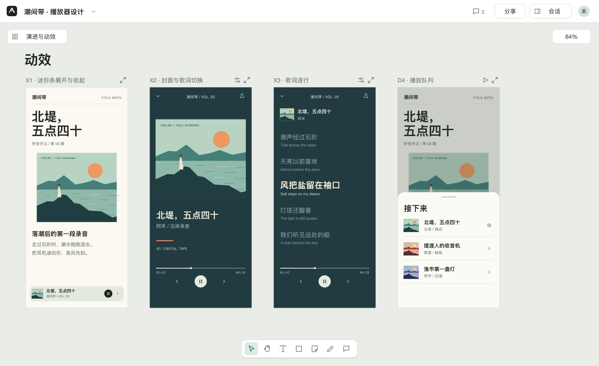

# 设计工作区：打开整页看方案，选中一板再操作

[查看完整设计稿（PDF，14 页）](workbench.pdf) · [总览大图](overview.png) · [检查器大图](properties.png) · [Claude Design 取证及演示出处](research.md)

这是 Akasha 的下一轮设计，不是功能发布。主线基准为 [`v0.4.1` / `5aa56dd`](https://github.com/VOD-Studio/akasha-artifacts/tree/5aa56dd2a3baff81f2bf5900e86856f848e4ffc6)；[现有工作区契约](../ued-workspace.md)继续有效。共 3 个页面、14 张 1440 × 880 的静态图。每页分别摆 4、6、4 张完整界面，不是一张含多个小窗口的长图。音乐、滑杆和按钮是所设计界面的画面，不是可操作演示。设计源码、工作区和历史制品分开。

**实机校订**：原 PDF 和已发布的画布保持不变。[操作栏](controls.png)与[展开播放菜单](play-menu.png)是两张另存的设计图。全局操作放页面、播放菜单、检查器、导出；画布工具单列为选择、抓手、文本、画板、便签、铅笔、形状、批注，缩放另列。单板有全窗打开或原型试玩；调参按声明、导出按权限出现。以这两图补正初稿对「静态板也能出现在全局 Play 菜单」的遗漏。

## 功能取舍

| 已有，保留 | 真正要补 | 不做／不要再造 |
| --- | --- | --- |
| 制品库有真实封面、搜索、收藏；能从已授权项目启动真实设计会话（#54、#61、#62）。 | 把设计内容放回第一屏；用稳定尺寸的骨架、空库、无结果、局部失败替代说明段落。P1 让简报带可移除、预览得到的参考图。 | 不增加仪表盘说明墙，不以假封面代表成功发布，不显示未接通的执行器。 |
| 同一制品已支持多页多板、稳定选区、布局、撤销；聚焦和试玩已分离（#53、#55、#56、#58、#59）。 | 同页对比；全局 Play 可以列出静态画板，板头只在真正可交互时出试玩；声明了总览动效的画板在原位静音循环。大页面按视域分级，缩满全页仍能找板。 | 不强制每页一板、不让点击选择穿透给原型、不在总览自动播音频或轮播整页，不为 1000 板常驻 1000 个 iframe。 |
| 检查器已有属性、源码、调参；可定位图层和版本源码；整份编辑器有冲突处理（#23–25、#57）。 | 区分画板结构属性、只读源码来源和作品作者定义的可调维度；无选区、有选区、固定快照与不同权限各有明确结果。 | 不加第四个通用标签，不把评论、会话、文件树或另一套 IDE 塞进检查器；不让任意运行时 DOM 冒充可持久化图层。 |
| 批注、Agent 对话、Hub 分享、定版导出、工程交接都已有端到端路径（#60、#61、#63–66）。 | 沿用原动作，改入口层级、作用范围和结果反馈；缺权限就不提供写操作。后续评估可复用的参考资源／设计系统。 | 不在本机伪造云分享；不把位置链接当授权，不把多人协作 #101 或可选 Workers #29 设为本期前置。 |

## 图稿怎么读

| PDF | 对应 Akasha 页面 | 看什么 |
| --- | --- | --- |
| 1–4 | 工作区与检查器 | 未开面板时横向并置 X1、X2、X3、D4；X2 的属性、源码、专属调参是同一个选区的三种视图。读得到的内容比控件重要：两档中性色、绿作选区、橙作作品点色，工具在画板外。 |
| 5–10 | 从创建到交付 | 作品库 → 带参考图的设计简报 → 左侧会话与右侧批注 → 指定画板试玩 → Hub 固定版本分享 → 单板导出。新建图是目标态，参考图与图中示例执行器必须实际可用才出现；v0.4.1 本机新建支持已连接的 Codex，本期不新增 CLI 适配器。 |
| 11–14 | 状态、规模与语言 | 四种系统状态；单页 1000 个轮廓并定位 #0512；德语长标签与阿拉伯语 RTL 库。同一组封面和作品专名不随界面语言翻译或镜像。 |

## A．选中一块，知道能看什么、能改什么（P0）

- **Properties｜属性**：无选区时保留可搜索的页面／画板树，不放整屏教程。整板选中显示固有宽高、背景、圆角；只在可写头版本提交，沿用基准版本检查、撤销／重做。原生图层才显示该类对象能改的字段。普通运行元素只显示能可靠测量的尺寸、间距、颜色和唯一来源。选区从板切到层，不保留上一块板的字段。
- **Code｜源码**：优先高亮当前快照唯一可定位的片段，否则老实退到本板或整稿，并标明范围。可写头版本可以转到已有整稿编辑器；固定版本与只读链接仅查看。同一检查器不再放第二套编辑器。权限和版本契约是 Akasha 的选择，不是声称 Claude 的 Code 页已证实只读。
- **Tweaks｜调参**：只有作品实际声明的控件才出现于板头和调参区。按画板稳定 ID 与参数 ID 绑定，不依赖展示文案或数组下标。首期支持有限数值／步长、枚举、布尔、颜色，声明含默认值和可翻译标签。演示选区是 X2：时长、冷暖、译文开关；切换画板不能串值。区分「当前画板」和已有模板的「整份作品」状态，不把后者复制到每块板。新单板参数在有编辑权的头版本**只作会话内预览**；切版丢弃、本板重置不影响他板，不改源码、分享和导出。固定／只读版本展示声明的默认值但不写。无控件只保留短空态，不伪造通用滑杆；可真实连接发布 Agent 时才提供请求新增控件入口。
- **P1**：图中打印模式与布局辅助线另做，不把暂未实现的字段装进当前产品。拟定 Fixed 按固有尺寸出单页并禁用纸型，Flow 允许选 Letter / A4 并按单板内容分页；辅助线为当前板，默认不导出。实施前用可分页真实材料验证，不将这一语义归给 Claude。

## B．100 / 1000 板能一次打开并定位（P0）

[当前画布](../../../apps/web/src/widgets/ArtifactWorkspace/ArtifactCanvas.tsx)遍历 `page.boards` 渲染，[检查器](../../../apps/web/src/widgets/ArtifactWorkspace/BoardInspector.tsx)也遍历画板建树。这不是协议只能放一张：本次用现行 `parseArtboard` 分别读入单页 100 和 1000 张不同 ID 的板，末板 `board-100`、`board-1000` 均存在。验证了数据模型，不代表浏览器流畅。

1. 每一版只为打开的页面建立 **世界坐标包围盒索引**，用稳定板 ID 定位；拖移、缩放画板只更新变动项。先用固定网格分桶，超大板进独立集合避免占满所有格。相机只做逆变换求视口＋缓冲，不在每次 pointermove 重排全页；同一帧合并一次更新。查询成本随触及的桶和候选项增长；全重叠／全可见时仍可能是 O(n)，不能把分桶说成永远 O(1)。
2. 按投影尺寸分三层：鸟瞰时单一绘制面画轮廓；可辨认时只给可见候选画真实静态缩略；近看且有声明才给总览动效，不因卸载而丢选区、批注锚点和相机。返回原位按制品、固定版本、板 ID、尺寸档复用缩略，限额 LRU；真实缩略没有生成完时显示骨架而非伪造封面。密集重叠按选区、距离及稳定次序降级；同一屏重叠的板仍能从树／搜索定位。画板与可访问的导航分开，树只挂可见行和当前焦点行，以免缩略优化完仍挂千行按钮。
3. **实施验收预算，不是本轮跑分**：1440 × 900，100／1000 板两档；鸟瞰运行中的画板为 0；近看最多 24 块高细节预览（其中最多 6 个轻量动效），整个工作区同时最多 1 个可操作试玩。10 秒连续缩放平移并回到同一板；记录设备、浏览器、刷新率、冷／热缓存、帧耗时 p95、长任务与活动实例峰值，以同一 Tern 环境对照基线；目标 60 Hz 下 p95 ≤ 24 ms。密集重叠、翻页、切后台、搜索 #0512、从批注跳到屏外及返回都是必测；不能用翻成千页或漏画选区换取达标。

## C．自己动、自己点、出声音是三回事（P0，依赖 B）

| 作者声明／用户动作 | 看见什么 | 输入与生命周期 |
| --- | --- | --- |
| 静态设计 | 全局 Play 的静态组可选；板头提供全窗查看，不冒充「试玩原型」 | 默认点击只选板；选择静态板打开聚焦视图，不启动交互运行时或音频。 |
| 有总览动效 | 画板在总览内循环，旁边的板可同时动；不要求开预览 | 壳层仅用无声的受限帧序列或有海报的静音媒体，不执行任意作者脚本。离屏、文档隐藏、用户暂停、减少动态偏好时停在海报；恢复只在仍符合预算时发生。 |
| 声明可交互，点 Play | 在隔离运行面真实点击／滚动／输入；可按已声明路径换板 | 进入试玩时停该板的总览实例，只把输入交给这一份。Esc 回到原页、相机、选区、触发控件。声音要求试玩内另一次明确操作；进入试玩本身不等于同意播音。 |
| 作者定义演示序列 | 将来可有带下一步／暂停的自动演示入口 | 独立于循环和 Play；P1 再做。没有序列，不显示、不计时、不偷偷跨板。 |

无可达声明的旧稿保留原有、可验证的试玩路径；不能因新元数据缺失把已有 HTML／React 交互清掉。静态 SVG 能被选作展示目标，但不能仅因承载在 HTML 里就获得单板试玩。选区覆盖层始终由宿主持有，不把制品脚本挪到主站执行。

## D．状态、语言、权限贯穿完整路径（P0，可与 A、B 并行）

- 库初次加载用封面骨架，无数据只给一个真实创建入口；搜索空结果保留关键词并可清除。仅一板失败，仅在该板显示重试；刷新同版不能清空其他板或抢走焦点。批注按需从右侧打开，开合不得挤压画布；会话离线不伪装正在执行。保存冲突、固定版本只读、分享权限不足：短状态与可执行动作，不是常驻教程。
- 标题／作品内容与壳层文案分开；文案键、复数、日期、相对时间、数字和单位使用语言资源与 `Intl`，不拼中英文句子。表单面板支持长标签换行，按钮图标有可访问名称，状态变化供读屏播报。布局用 inline-start/end，RTL 镜像导航与返回方向，不镜像海岸插画、媒体进度、画布世界坐标；源码和版本 ID 隔离为 LTR。中文、德语长词、阿语 RTL，分别过库→选板→面板→导出；语言变化不改对象 ID、选区或历史链接。
- 创建、批注、试玩和导出沿用可用路径。任何附件必须真正到达被授权 Agent，删除后不再随简报发送；云分享要能解释角色与固定版本，离线 HTML 与定版 PDF 不携带私人会话及临时调参。团队资产库、跨项目设计系统、原型录制为 MP4、集成邮箱邀请、通用代码 IDE 不属于 P0。

验收按 **A / B / C / D 四条用户路径**记录，不拆成「先搭框架、再接按钮」。能并行的先做；C 只在 B 的资源上限可以验证后验收。业务优先保住普通设计、已有历史链接和操作权限，不以外观对齐为理由回退已有能力。

## 重建设计源

在仓库根目录运行 `node docs/design/workspace-next/plates.mjs .artifacts/workspace-next`，得到可在 Akasha 发布为 `artboard` 的 `workspace.artboard.json` 及每张 SVG。PDF 按上述顺序由仓库中[现有 PDF 导出器](../../../apps/web/src/features/export-design/design-pdf.ts)合成。稿内「千板」真的画了 1000 个轮廓和一个选区，但它是静态示意，不是性能测试结果。
